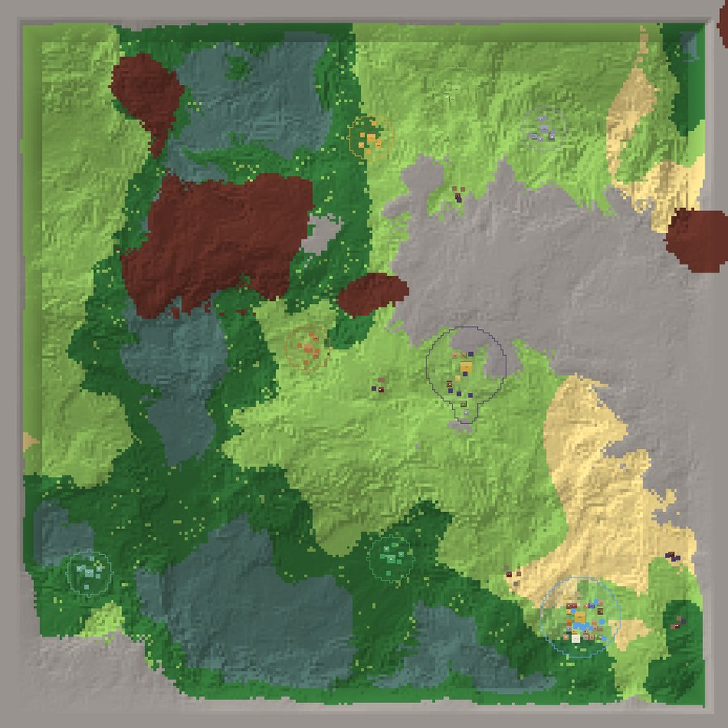
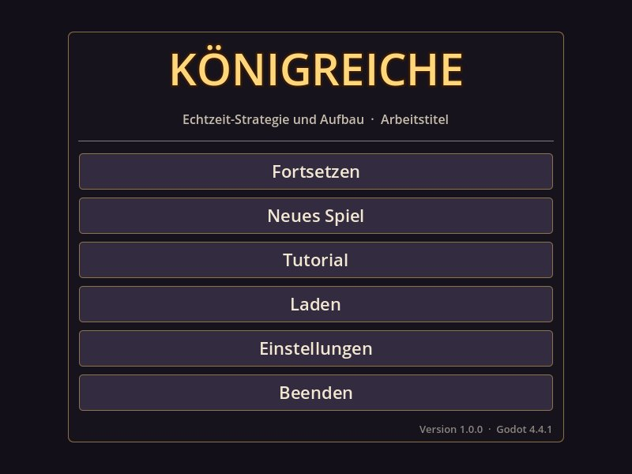

# Königreiche

[](https://github.com/Louidos/Kings_and_Spyes_1/actions/workflows/tests.yml)


**2D-Echtzeit-Strategie- und Aufbauspiel in Godot 4 (GDScript), Ansicht von oben.** Du bist ein König, wählst die
Seite des Lichts oder der Finsternis und dein Volk (sechs je Seite), baust aus fünf Bewohnern ein Dorf auf, beschwörst
Truppen, erforschst Zauber und wirbst Helden an. Rund um dich leben zehn freie Völker in neutralen Dörfern – gewinne
sie mit Geschenken und Verträgen oder unterwirf sie. Irgendwo auf der prozedural erzeugten Karte wachsen die Reiche
der Gegenseite. Bleib unentdeckt, solange du schwach bist, und besiege sie, bevor sie dich finden.


| | |
|---|---|
|  |  |
| **Armeefenster** – alle Krieger, Armeen und Befehle | **Forschung** – vier Zweige, vier Stufen je Fraktion |
|  |  |
| **Diplomatie** – Ruf, Geschenke, Handel, Verträge | **Die Welt** – Biome, Dörfer, Reiche, Monsterlager |

## Inhalt

- [Was dich erwartet](#was-dich-erwartet)
- [Schnellstart](#schnellstart)
- [Die wichtigsten Tasten](#die-wichtigsten-tasten)
- [Dokumentation](#dokumentation)
- [Projektstand](#projektstand)
- [Ordner im Überblick](#ordner-im-überblick)
- [Mitmachen](#mitmachen)
- [Lizenz](#lizenz)

## Was dich erwartet

**Welt**
- Prozedurale Karte in drei Grössen (256² bis 1024² Kacheln) mit sechs Biomen, Rohstoffvorkommen und Grenzgebirge.
- Gleicher Seed = gleiche Welt. Gelände beeinflusst Tempo, Verteidigung und die Boni der Völker.

**Dorf & Wirtschaft**
- Fünf Ressourcen (Holz, Stein, Erz, Nahrung, Mana), über 20 Gebäude, Strassen, Gebiet, das mit jedem Gebäude wächst.
- **Gebäude ausbauen** auf Stufe II und III; die **Königsburg** wächst vom Weiler über Dorf und Stadt zum Königssitz
  und schaltet dabei Gebäude frei.
- **Bewerber** mit Namen, Wunschberuf und eigenen Bedingungen statt automatischem Zuwachs; Bewohner mit Berufen,
  Hungersnot – und **Zufriedenheit**: Taverne, Tempel und Feste halten die Leute bei Laune, sonst laufen sie über.

**Truppen & Kampf**
- Je Fraktion zwölf Truppentypen in sechs Klassen mit **Kontern** (Speer schlägt Reiter, Reiter überrennen Schützen …),
  dazu Volkskrieger verbündeter Dörfer und Belagerungswaffen.
- **Ränge** mit Wertepunkten, **Schmiede** mit Waffen- und Rüstungsstufen je Klasse, **Aussehen** (Skins).
- Armeen 1–9, Formationen, **Haltungen** (aggressiv, verteidigend, passiv) und das **Armeefenster** für Befehle an alle.

**Helden & Magie**
- Drei Helden je Fraktion mit eigenen Anwerbe-Bedingungen, Fähigkeiten, Stufen, Talenten, Führung und Wiederbelebung.
- Forschungsbaum mit vier Zweigen; der König zaubert Segen, Flüche, Heilung, Tarnung, Wetter und Beschwörungen.

**Diplomatie & Spionage**
- Neutrale Dörfer mit Ruf: Geschenke, Tauschhandel, Schutz-, Handels- und Bündnisverträge, Aufnahme, Drohung, Krieg,
  Boten.
- Gegnerische KI-Reiche entdecken dich erst, wenn du auffällst. Spione kundschaften aus und hetzen Dörfer oder Rivalen
  auf.

**Ereignisse**
- Dürre, Seuche, Magiesturm, Monsterwellen, Flüchtlinge, Wanderer, Erntedank und Manablüte – für alle Reiche.
- Tag und Nacht mit eigenen Boni der Völker, wachsende Monsterlager und Streifzüge.
- Mauern, Tore, Türme, Belagerung und Handelswege mit Karawanen.

**Speichern**
- Benannte Spielstände, Schnellspeichern (F5/F8), Autospeichern; vier Schwierigkeitsgrade; Tutorial in 37 Schritten.

## Schnellstart

1. **Godot installieren:** [Godot 4.4 oder neuer](https://godotengine.org/download), *Standard*-Version (nicht .NET).
   Getestet mit 4.4.1 und 4.7. Der Renderer *Compatibility* läuft auch auf älteren Grafikkarten.
2. **Projekt holen:** dieses Repository herunterladen (grüner Knopf *Code → Download ZIP*, entpacken) oder klonen.
3. **Importieren:** Godot starten → **Importieren** → `project.godot` in diesem Ordner wählen → *Importieren &
   Bearbeiten*. Beim ersten Öffnen importiert Godot alle Dateien (dauert einen Moment).
4. **Starten:** **F5** (Projekt ausführen) → Hauptmenü.
5. **Lernen:** Im Hauptmenü **Tutorial** wählen – eine freundliche Partie, die Schritt für Schritt alles zeigt.
   Danach **Neues Spiel**: Fraktion, Volk, Schwierigkeit, Kartengrösse und Seed wählen.

 

> F5 startet nur im Editor das Projekt – im laufenden Spiel ist F5 *Schnellspeichern*.

## Die wichtigsten Tasten

| Taste | Wirkung | Taste | Wirkung |
|---|---|---|---|
| **WASD** / Mausrad | Kamera / Zoom | **R** | Forschung |
| **Leertaste** | Pause | **G** | Helden |
| **+ / −** | Spieltempo | **T** | Armee |
| **Linksklick** / Rahmen | auswählen | **N** | Diplomatie |
| **Rechtsklick** | bewegen / angreifen | **K** | Spionage |
| **Strg + Rechtsklick** | angreifend vorrücken | **L** | Reich (Zufriedenheit, Ereignisse) |
| **Strg + 1…9** / **1…9** | Armee speichern / wählen | **J** | Arbeitsverteilung |
| **Strg + A** | alle Krieger | **M** | Meldungsprotokoll |
| **C / V / B** | Heldenfähigkeiten | **F1** | Hilfe |
| **F** | Formation | **F5 / F8** | Schnellspeichern / -laden |
| **X** | Abreissen | **Esc** | Fenster schliessen, Spielmenü |

Alle Tasten: [docs/steuerung.md](docs/steuerung.md) – im Spiel auch unter **F1**.

## Dokumentation

| Dokument | Für wen | Inhalt |
|---|---|---|
| [Spielanleitung](docs/spielanleitung.md) | Spielende | Ziel, alle 22 Völker, Gebäude, Truppen mit Kontern, Ränge, Schmiede, Helden, Forschung, Zauber, Diplomatie, Spionage, Ereignisse, Tipps |
| [Steuerung](docs/steuerung.md) | Spielende | alle Tasten und Mausbefehle, Testhilfen |
| [Daten anpassen](docs/daten-anpassen.md) | Gestaltung, Modding | jede Datei in `data/`, Beispiele: billigere Häuser, stärkere Ritter, mehr Dörfer, neue Einheit, neues Ereignis |
| [Grafiken austauschen](docs/grafiken.md) | Gestaltung | Platzhalter ersetzen, Grössen, Namen, Skins, Prompt-Vorlagen für die Bild-KI |
| [Grafikliste](assets_liste.md) | Gestaltung | jede Grafikdatei mit Name, Grösse und Bildbeschreibung |
| [Architektur](docs/architektur.md) | Entwicklung | Systeme, Aufbau-Reihenfolge, Signale, Quellen-Prinzip, Speichern, KI, Export |
| [Testen](docs/testen.md) | Entwicklung | automatische Prüfungen, Rauchtests, Bildschirmfotos, Checklisten je Phase |
| [Balancing](docs/balancing.md) | Gestaltung, Entwicklung | Messwerte der KI-Läufe, Stellschrauben |
| [Änderungen](CHANGELOG.md) | alle | Verlauf von Phase 1 bis heute |

## Projektstand

**Version 1.1.0 – spielbar und vollständig.** Alle zehn geplanten Ausbaustufen sind fertig, dazu Armeefenster,
Truppen-Erweiterung, Tutorial und eine aufgeräumte Oberfläche. Neu in 1.1.0: Gebäudestufen, Burgstufen, Bewerber und
Helden mit eigenen Bedingungen – das Reich wächst langsamer und über Stufen (Details im [Changelog](CHANGELOG.md)).

- [x] Phase 1 – Projekt-Setup, Kamera, prozedurale Karte mit Biomen, Spieltempo und Pause
- [x] Phase 2 – Dorf: Gebäude, Ressourcen, Bewohner, Arbeitsverteilung
- [x] Phase 3 – Einheiten: Beschwören, Auswahl, Bewegung, Kampf, Armeen
- [x] Phase 4 – Forschung, Mana und Magie
- [x] Phase 5 – Helden
- [x] Phase 6 – Neutrale Dörfer, Diplomatie, Handel, Ruf, Boten
- [x] Phase 7 – Gegnerische Königreiche mit KI, Entdeckung, Spionage
- [x] Phase 8 – Zufriedenheit, Verrat, Flüchtlinge, Ereignisse, Monster, Tag/Nacht
- [x] Phase 9 – Belagerungen und Handelswege
- [x] Phase 10 – Speichern/Laden, Schwierigkeitsgrade, UI-Feinschliff, Balancing
- [x] Armeefenster, Truppen (Klassen, Schmiede, Ränge, Aussehen), Tutorial, aufgeräumte Oberfläche
- [x] 1.1.0 – Gebäudestufen, Burgstufen mit Freischaltungen, Bewerber statt automatischem Wachstum, Helden-Bedingungen

**Noch offen:**

- **Grafiken:** Das Spiel nutzt automatisch gezeichnete Platzhalter. Echte Bilder (Anime-Stil, von oben) werden nach
  und nach mit einer Bild-KI erzeugt – siehe [Grafiken austauschen](docs/grafiken.md) und die
  [Grafikliste](assets_liste.md).
- **Ton:** Lautstärke-Regler sind da, Musik und Geräusche fehlen noch.
- **Lizenz:** noch nicht gewählt (siehe unten).

## Ordner im Überblick

```
project.godot      Projekteinstellungen, Tastenbelegung
data/              Spieldaten (JSON) – Werte ändern ohne Code
scenes/            Szenen: Hauptmenü, Spiel, Oberfläche
scripts/           GDScript: Systeme, KI, Oberfläche, Speichern
assets/            Grafiken (Platzhalter werden durch PNGs ersetzt), Theme, Ton
tests/             Skriptprüfung, Rauchtests, Balancing, Bildschirmfotos
tools/             Hilfsprogramme (Tabellen der Anleitung erzeugen)
docs/              Anleitungen und Bilder
assets_liste.md    Liste aller Grafiken für die Bild-KI
```

Ausführlich: [Architektur → Ordnerstruktur](docs/architektur.md#ordnerstruktur).

## Mitmachen

- **Fehler gefunden oder eine Idee?** Ein [Issue](../../issues/new/choose) anlegen – es gibt Vorlagen für
  Fehlermeldungen und Ideen.
- **Werte ändern** geht ohne Programmieren: [Daten anpassen](docs/daten-anpassen.md).
- **Code ändern:** vorher die [Architektur](docs/architektur.md) lesen, danach prüfen:
  ```bash
  GODOT=/pfad/zu/godot tests/check_scripts.sh     # Fehler und Warnungen
  GODOT=/pfad/zu/godot tests/run_smoke.sh 600     # Rauchtest beider Fraktionen
  ```
  Dasselbe läuft bei jedem Push automatisch in GitHub Actions ([Testen](docs/testen.md)).
- Texte, Kommentare und Commits auf Deutsch (Schweizer Schreibweise, ss statt Eszett).

## Lizenz

Für dieses Projekt ist **noch keine Lizenz gewählt**. Bis dahin gilt das Urheberrecht des Eigentümers: Ansehen und
Ausprobieren ja, Weitergeben oder Verwenden in eigenen Projekten nur mit Erlaubnis. Eine Lizenz (z. B. MIT für den
Code, CC BY für Grafiken) wird später ergänzt.
