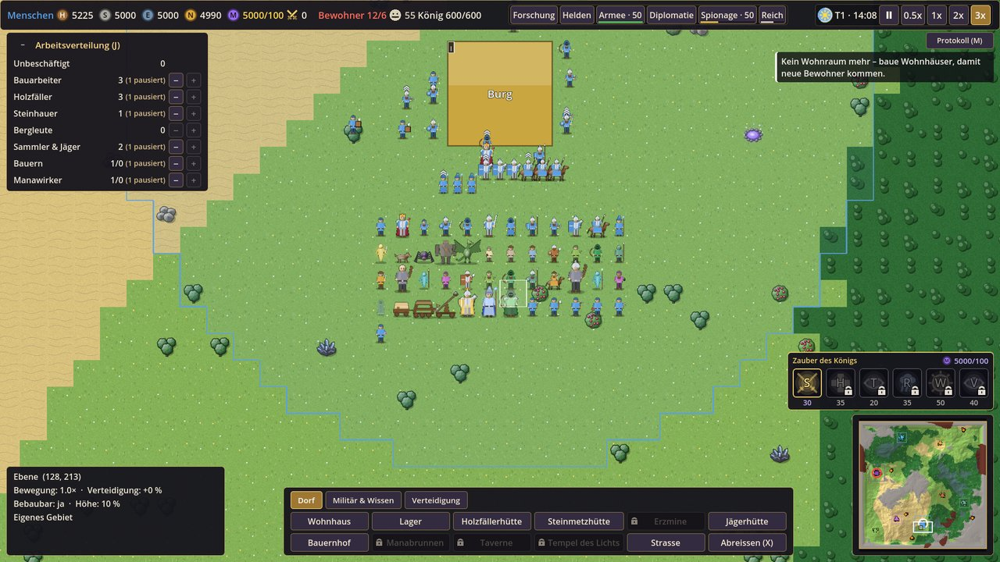

# Grafiken austauschen

Das Spiel kommt ganz ohne Bilddateien aus: Alles, was du siehst, ist **automatisch gezeichnet** (farbige Flächen
mit Kurztext für Gebäude, Muster für das Gelände und **gezeichnete Spielfiguren** für alle Einheiten). Sobald eine PNG-Datei mit dem
richtigen Namen am richtigen Ort liegt, nimmt das Spiel beim nächsten Start diese Datei – **ohne Code-Änderung**.

Die vollständige Liste aller Dateien mit Namen, Grösse und Bildbeschreibung steht in
**[`assets_liste.md`](../assets_liste.md)** (im Hauptordner).

## Inhalt

1. [So funktioniert der Austausch](#so-funktioniert-der-austausch)
2. [Grössen und Ordner](#grössen-und-ordner)
3. [Dateinamen](#dateinamen)
4. [Arbeitsablauf mit der Bild-KI](#arbeitsablauf-mit-der-bild-ki)
5. [Prompt-Vorlagen](#prompt-vorlagen)
6. [Gezeichnete Spielfiguren](#gezeichnete-spielfiguren)
7. [Aussehen (Skins)](#aussehen-skins)
8. [Burgen je Volk und Dörfer](#burgen-je-volk-und-dörfer)
9. [Häufige Fragen](#häufige-fragen)

## So funktioniert der Austausch

1. In [`assets_liste.md`](../assets_liste.md) die gewünschte Grafik suchen, z. B. `house_good.png` (Wohnhaus GUT).
2. Bild erzeugen (siehe [Prompt-Vorlagen](#prompt-vorlagen)), auf die Zielgrösse bringen, als **PNG** speichern.
3. Datei in den genannten Ordner legen, z. B. `assets/sprites/buildings/house_good.png`.
4. Projekt im **Godot-Editor** öffnen (oder auf „Projekt neu laden“ klicken): Godot importiert die Datei und legt
   daneben eine `.import`-Datei an. Dann F5 – das Wohnhaus hat sein neues Bild.
5. Beim Einchecken ins Git-Repository **die PNG und die `.import`-Datei** mitnehmen.

Fehlt eine Datei oder ist der Name falsch, zeichnet das Spiel einfach weiter den Platzhalter bzw. die Figur – es geht
nichts kaputt.

> Ohne Editor lädt das Spiel eine neue PNG zwar auch direkt, für den **Export** (fertige .exe) muss sie aber vom
> Editor importiert worden sein.

## Grössen und Ordner

| Art | Grösse (px) | Hintergrund | Ordner |
|---|---|---|---|
| Gelände-Kacheln (4 Varianten je Biom, Strasse) | 64 × 64 | **voll deckend**, nahtlos kachelbar | `assets/sprites/terrain/` |
| Einheiten (Bewohner, Truppen, Monster, Milizen, Spione …) | 64 × 64 | transparent | `assets/sprites/units/` |
| Helden | 64 × 64, Porträt 128 × 128 | transparent | `assets/sprites/heroes/` |
| Gebäude 2 × 2 Felder | 128 × 128 | transparent | `assets/sprites/buildings/` |
| Gebäude 3 × 3 Felder (Heldenhalle, Tempel, Werkstatt, Dorfzentrum) | 128 × 128 (wird auf die Grundfläche gestreckt) | transparent | `assets/sprites/buildings/` |
| Reitstall (3 × 2 Felder) | 192 × 128 | transparent | `assets/sprites/buildings/` |
| Burg (4 × 4 Felder) | 256 × 256 | transparent | `assets/sprites/buildings/` |
| Rohstoffe auf der Karte | 64 × 64 | transparent | `assets/sprites/resources/` |
| Effekte (Geschosse, Ruinen, Ereignisflächen) | 64 × 64 bis 256 × 256 | transparent | `assets/sprites/effects/` |
| Symbole (Ressourcen, Ereignisse, Stimmung) | 32 × 32 | transparent | `assets/ui/icons/` |
| Zauber- und Fähigkeitssymbole | 64 × 64 | transparent | `assets/ui/icons/` |
| Menü-Hintergrund | 1920 × 1080 | voll deckend | `assets/ui/` |

Die Grafik füllt die Grundfläche des Gebäudes. Baustellen, Lebensbalken, Auswahlringe, Rangabzeichen und die
Abzeichen der Skins zeichnet das Spiel selbst.

## Dateinamen

- **Klein**, ohne Umlaute und Leerzeichen, mit Unterstrich: `mage_tower_evil.png`.
- Gebäude und Truppen gibt es meist **je Fraktion**: `<id>_good.png` und `<id>_evil.png`.
- Gelände: `terrain_<biom>_<1…4>.png`, z. B. `terrain_forest_3.png`.
- Skins: `<einheit>_<skin>.png`, z. B. `fighter_good_royal.png`.
- Der Pfad steht auch in den Daten (`data/*.json`, Felder `sprite`, `sprites`, `icon`) – dort lässt er sich ändern,
  falls eine Datei anders heissen soll.

## Arbeitsablauf mit der Bild-KI

1. **Gross erzeugen**: z. B. 512 × 512 (Burg 1024 × 1024), dann auf die Zielgrösse verkleinern – so bleiben die
   Umrisse sauber.
2. **Transparenz**: Einheiten, Gebäude und Symbole brauchen einen transparenten Hintergrund. Erzeugt die KI einen
   einfarbigen Hintergrund, ihn mit einem Bildprogramm (z. B. GIMP, Photopea, remove.bg) entfernen.
3. **Blickrichtung**: von oben (Top-Down), Einheiten schauen nach unten (zum Betrachter). Links/rechts spiegelt das
   Spiel selbst.
4. **Mittig, mit etwas Rand**, kein Schlagschatten auf dem Hintergrund. Einheiten stehen mit den Füssen im unteren
   Drittel.
5. **Gelände nahtlos**: Kachel 2 × 2 nebeneinanderlegen und prüfen, ob Kanten sichtbar sind. Die vier Varianten
   eines Bioms nur leicht unterscheiden (gleiche Grundfarbe, andere Details) – das Spiel mischt sie zufällig.
6. **Einheitlicher Stil**: Anime, von oben, farbenfroh, klare Silhouetten, gut lesbare Umrisse. GUT hell (Fachwerk,
   Stein, blaue Dächer, Gold), BÖSE dunkel (Stacheln, rote und violette Akzente).
7. Datei ablegen, in Godot importieren, im Spiel ansehen (auch weit herausgezoomt), dann einchecken.

## Prompt-Vorlagen

Einheit / Gebäude:

> anime style game sprite, top-down view, **[MOTIV]**, vibrant colors, clean bold outlines,
> clear silhouette, centered, transparent background, no text, 64x64 pixel game asset

Gelände-Kachel:

> seamless tileable texture, top-down view, anime style, **[GELÄNDE]**, vibrant colors,
> flat even lighting, no shadows from objects, fills the entire square, 64x64 pixel game tile

Symbol:

> flat game icon, **[MOTIV]**, bold outline, vibrant colors, centered, transparent background, no text, 32x32 icon

Beispiele für `[MOTIV]`:

| Datei | Motiv |
|---|---|
| `house_good.png` | small cozy timber-framed house with blue roof, seen from above |
| `house_evil.png` | crooked dark wooden hut with spikes and red lanterns, seen from above |
| `fighter_good.png` | human swordsman in shining armor with round shield, facing down |
| `cavalry_evil.png` | orc rider on a huge black wolf, facing down |
| `terrain_forest_1.png` | dense green tree canopies seen from above |
| `icon_mana.png` | glowing violet mana crystal |

Die Beschreibungen aller Motive (auf Deutsch) stehen in [`assets_liste.md`](../assets_liste.md) – für die Bild-KI ins
Englische übersetzen und in die Vorlage einsetzen.

## Gezeichnete Spielfiguren

Solange in `assets/sprites/units/` bzw. `assets/sprites/heroes/` keine Datei liegt, zeichnet das Spiel jede Einheit
als **Figur** (`scripts/util/figure_art.gd`): Körper, Kopf und Kopfbedeckung, dazu die Waffe der Klasse (Schwert und
Rundschild, Speer, Bogen, Armbrust, Lanze zu Pferd, Zauberstab, Streitkolben mit Turmschild …), bei Bewohnern das
Werkzeug ihres Berufs (Hammer, Axt, Spitzhacke, Korb, Sichel, Manakugel). Der Wappenrock trägt die **Farbe des
Reichs**; **Licht** (GUT) hat helle Haut und blanken Stahl mit Helmbusch, **Finsternis** (BÖSE) graue Haut, glühende
Augen und dunkles Eisen mit Hörnern und Dornen. **Helden** sind grösser, tragen einen Umhang und eine Aura, eine
Krone oder einen Heiligenschein, **Spione** Kapuze und Umhang, **Reiter** sitzen auf Pferd oder Wolf. **Monster**
haben je Art eine eigene Form (Wolf, Spinne, Golem, Wyvern), Belagerungswaffen und Karawanen sind Fahrzeuge.

Jedes Aussehen wird **einmal erzeugt** und von allen gleich aussehenden Einheiten geteilt – auch mit Hunderten
Einheiten bleibt das Zeichnen so billig wie mit den früheren Scheiben.

**Was eine Figur trägt, steht in den Daten** (ohne Code-Änderung):

- `data/units.json` → `figures`: Teile je Stufe (`tiers`), Werkzeug je Beruf (`jobs`), Haut, Metall und Augen je
  Fraktion (`factions`), Grösse auf der Karte (`draw_scale`, `hero_scale`). Die erlaubten Werte stehen dort im
  `_hinweis`.
- Am Einheitentyp `figure`, z. B. `"figure": {"gear": "axe", "head": "beard", "shield": "round"}` für die Zwergenmiliz.
- In `data/heroes.json` am Helden `figure` (Waffe, Umhang, `mark`: `aura`, `halo` oder `crown`).

**Echte Grafik einsetzen:** Liegt die Datei aus `sprite`/`sprites` (z. B. `assets/sprites/units/fighter_good.png`,
`assets/sprites/heroes/hero_paladin.png`) vor, hat sie **immer Vorrang** vor der gezeichneten Figur. Für ein Bild,
das zu den Figuren passt: 64 × 64, transparent, Figur von vorn, Füsse knapp über dem unteren Rand, Kopf im oberen
Fünftel. Man kann Einheiten einzeln austauschen – gezeichnete und echte Figuren lassen sich mischen.

## Aussehen (Skins)

Skins sind rein kosmetische Farbvarianten der Truppen (Auswahlfenster → „Aussehen“). Fehlt die Datei
`<einheit>_<skin>.png`, nimmt das Spiel die normale Grafik der Einheit **leicht getönt** in den Skin-Farben, ohne
Grafik die **gezeichnete Figur in den Skin-Farben mit dem Muster des Skins** auf dem Wappenrock (und auf dem Schild) –
immer mit einem gezeichneten Abzeichen oben links.

| Skin-ID | Name | Fraktion | Farben / Muster / Abzeichen |
|---|---|---|---|
| `royal` | Königsgarde | GUT | königsblau mit Gold, geviertelt, Krone |
| `sunwatch` | Sonnenwacht | GUT | hellgelb mit Weiss, Mittelstreifen, Sonne |
| `shadow` | Schattenwache | BÖSE | schwarzviolett, Schärpe, Mond |
| `blood` | Blutbanner | BÖSE | dunkelrot, Sparren, Reisszahn |
| `hero_banner` | Heldenbanner | alle (einzelne Einheiten ab Rang Elite) | Gold mit Weiss, Saum, Stern |

Beispiele: `units/fighter_good_royal.png`, `units/cavalry_evil_blood.png`, `units/spearman_good_hero_banner.png`.
Einen neuen Skin legt man in `data/troops.json` → `skins.variants` an (siehe
[Daten anpassen](daten-anpassen.md#weitere-schnelle-änderungen)).

## Burgen je Volk und Dörfer

- **Burg je Volk** (optional): `castle_<volk>.png`, z. B. `castle_orcs.png` (256 × 256). Fehlt sie, nimmt das Spiel
  `castle_good.png` bzw. `castle_evil.png`.
- **Dorfzentren und Hütten** je neutralem Volk, **Milizen** und **Volkskrieger**: Namen in
  [`assets_liste.md`](../assets_liste.md), Abschnitt „Phase 6 – Neutrale Völker“. Ohne Datei zeichnet das Spiel sie in
  der Farbe des Volks (Milizen und Volkskrieger als Figuren mit eigener Waffe, siehe `figure` in `data/units.json`).

## Häufige Fragen

**Das neue Bild erscheint nicht.** Name und Ordner prüfen (Gross-/Kleinschreibung!), Endung `.png`. Im Editor
einmal „Projekt → Projekt neu laden“. Steht der Pfad in `data/*.json` anders, gilt der Pfad aus den Daten.

**Das Bild ist verschwommen oder zu klein.** Auf die Zielgrösse verkleinern (nicht kleiner), mit etwas Rand. Sehr
feine Details gehen bei 64 × 64 verloren – lieber klare Formen und kräftige Umrisse.

**Gibt es Animationen?** Noch nicht – je Einheit ein Standbild. Treffer und Tod zeichnet das Spiel selbst (Treffer
blitzen auf, Gefallene verblassen).

**Ton und Musik?** Die Lautstärke-Regler gibt es schon (Busse *Master*, *Music*, *SFX*, *UI*), das Spiel spielt aber
noch keine Tondateien ab. Sie gehören später nach `assets/audio/music/` bzw. `assets/audio/sfx/` (OGG).
