# Spielanleitung

Alles, was du zum Spielen von **Königreiche** wissen musst – vom ersten Wohnhaus bis zum Fall des letzten
feindlichen Reichs. Die Tasten stehen gesammelt in der [Steuerung](steuerung.md).

> Die Tabellen mit Zahlen (Völker, Gebäude, Truppen, Forschung, Zauber, Helden, Ereignisse, Schwierigkeit) werden
> mit `python3 tools/doku_tabellen.py` direkt aus den Spieldaten in `data/` erzeugt und stimmen deshalb mit dem
> Spiel überein. Ändert man Werte in `data/`, das Werkzeug einfach noch einmal laufen lassen.

## Inhalt

1. [Worum es geht](#1-worum-es-geht)
2. [Eine Partie beginnen](#2-eine-partie-beginnen)
3. [Der Bildschirm](#3-der-bildschirm)
4. [Fraktionen und Völker](#4-fraktionen-und-völker)
5. [Wirtschaft und Gebäude](#5-wirtschaft-und-gebäude)
6. [Bewohner und Berufe](#6-bewohner-und-berufe)
7. [Zufriedenheit](#7-zufriedenheit)
8. [Truppen und Kampf](#8-truppen-und-kampf)
9. [Ränge, Wertepunkte und Aussehen](#9-ränge-wertepunkte-und-aussehen)
10. [Schmiede](#10-schmiede)
11. [Befehle, Armeen und Haltungen](#11-befehle-armeen-und-haltungen)
12. [Helden](#12-helden)
13. [Forschung, Mana und Zauber](#13-forschung-mana-und-zauber)
14. [Neutrale Dörfer und Diplomatie](#14-neutrale-dörfer-und-diplomatie)
15. [Gegnerische Reiche, Entdeckung und Spionage](#15-gegnerische-reiche-entdeckung-und-spionage)
16. [Ereignisse, Flüchtlinge und Monster](#16-ereignisse-flüchtlinge-und-monster)
17. [Tag und Nacht](#17-tag-und-nacht)
18. [Mauern, Belagerung und Handelswege](#18-mauern-belagerung-und-handelswege)
19. [Sieg und Niederlage](#19-sieg-und-niederlage)
20. [Schwierigkeitsgrade](#20-schwierigkeitsgrade)
21. [Speichern und Laden](#21-speichern-und-laden)
22. [Tipps für den Einstieg](#22-tipps-für-den-einstieg)

---

## 1. Worum es geht

Du bist ein **König**. Du wählst die Seite des Lichts (**GUT**) oder der Finsternis (**BÖSE**) und ein Volk, baust
aus fünf Bewohnern ein Dorf auf, beschwörst Truppen, erforschst Zauber, wirbst Helden an und gewinnst neutrale
Dörfer als Freunde – oder unterwirfst sie. Irgendwo auf der Karte wachsen die Reiche der Gegenseite, gesteuert von
der KI. Sie bemerken dich erst, wenn dein Reich auffällt, und greifen dann in Wellen an.

- **Sieg:** Alle feindlichen Königreiche sind gefallen (ihr König ist tot oder ihre Burg zerstört).
- **Niederlage:** Dein König stirbt oder deine Burg fällt.

Die Spielwelt läuft in Echtzeit. Ein Spieltag dauert bei Tempo 1x **10 Minuten** (600 Sekunden), eine Spielstunde
also 25 Sekunden. Mit der Leertaste pausierst du, mit + / − änderst du das Tempo (0.5x bis 3x).

## 2. Eine Partie beginnen

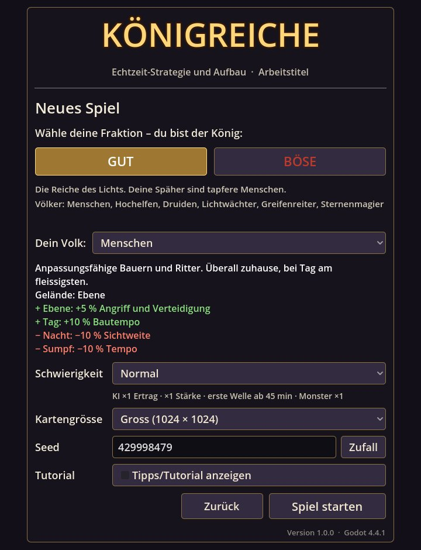

Hauptmenü → **Neues Spiel**:

- **Fraktion** – GUT oder BÖSE. Gebäude, Truppen, Forschung, Zauber und Helden sind je Seite verschieden, die
  Regeln dieselben.
- **Dein Volk** – eines von sechs Völkern deiner Fraktion mit eigenen Stärken und Schwächen
  (siehe [Völker](#4-fraktionen-und-völker)).
- **Schwierigkeit** – Leicht, Normal, Schwer oder Episch (siehe [Schwierigkeitsgrade](#20-schwierigkeitsgrade)).
  Sie gehört zur Partie und lässt sich später nicht ändern.
- **Kartengrösse** – Klein (256 × 256 Kacheln), Mittel (512 × 512) oder Gross (1024 × 1024). Auf grösseren Karten
  gibt es mehr Dörfer, Monsterlager und Platz.
- **Seed** – ein beliebiger Text oder eine Zahl. Gleicher Seed = gleiche Welt. „Zufall“ würfelt einen neuen.
- **Tipps/Tutorial anzeigen** – startet das Tutorial in dieser Partie.

**Tutorial:** Wer das Spiel zum ersten Mal spielt, wählt im Hauptmenü **Tutorial**. Es startet eine feste,
freundliche Partie (Seed „Lernreich“, kleine Karte, Leicht, ein Gegnerreich) und führt in **37 Schritten** durch
acht Kapitel: Erste Schritte · Dein Dorf · Einheiten · Armee und Truppen · Wissen und Magie · Helden · Reich und
Nachbarn · Speichern und Hilfe. Ein goldener Rahmen zeigt den Knopf, ein Pfeil die Stelle in der Welt. Lange
Schritte lassen sich überspringen, der Hofschatzmeister schenkt dir die nötigen Rohstoffe, und solange das
Tutorial läuft (höchstens 120 Spielminuten), greifen dich weder Gegner noch Ereignisse an. Im Spielmenü (Esc)
lässt es sich fortsetzen oder neu beginnen.

 

## 3. Der Bildschirm

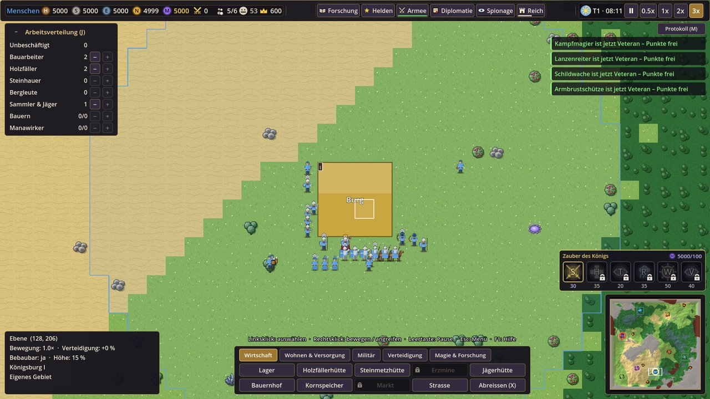

| Bereich | Inhalt |
|---|---|
| **Obere Leiste links** | Volk, Ressourcen (Holz, Stein, Erz, Nahrung, Mana mit Höchstwert), Kampfpunkte (gekreuzte Schwerter), Bewohner/Wohnraum, Zufriedenheit (Gesicht), Leben des Königs |
| **Obere Leiste Mitte** | Knöpfe für die Fenster *Forschung · Helden · Armee · Diplomatie · Spionage · Reich*. Zahl, Strich und roter Punkt zeigen den Stand (z. B. „Armee · 22“, roter Punkt = Kampf), die Taste steht im Tooltip |
| **Obere Leiste rechts** | Sonne/Mond, Tag und Uhrzeit, Pause und Tempo (0.5x, 1x, 2x, 3x) |
| **Links oben** | Arbeitsverteilung (Taste J; „−“ klappt sie ein) |
| **Links unten** | Auswahlfenster (was du angeklickt hast), Armee- und Heldenleiste, Infobereich (Gelände und Gebiet unter der Maus) |
| **Unten Mitte** | Baumenü mit drei Reitern: *Dorf*, *Militär & Wissen*, *Verteidigung* |
| **Rechts** | Meldungen (Klick springt zur Stelle), „Protokoll (M)“, Zauberleiste des Königs, Minikarte |

Alle Fenster in der Mitte sehen gleich aus: Titel und Wappen links, Reiter und „ד rechts, unten eine Zeile mit
Hinweisen und der Taste zum Schliessen. Es ist immer nur ein Fenster offen; Esc schliesst es. Die Grösse der
Oberfläche lässt sich unter Esc → Einstellungen von 75 bis 150 % einstellen.

## 4. Fraktionen und Völker

Es gibt **22 Völker**: je sechs für GUT und BÖSE (spielbar) und zehn neutrale Völker, die in Dörfern auf der Karte
leben. Dein Volk gibt dir Boni auf seinem Lieblingsgelände und zu bestimmten Tageszeiten (sichtbar im
Auswahlfenster einer Einheit und in der Reichsübersicht unter „Volk & Tageszeit“). Die KI-Reiche haben ebenfalls
ein Volk.

<!-- AUTO:voelker -->

**GUT** – spielbare Völker

| Volk | Beschreibung | Lieblingsgelände | Stärken | Schwächen |
|---|---|---|---|---|
| **Menschen** | Anpassungsfähige Bauern und Ritter. Überall zuhause, bei Tag am fleissigsten. | Ebene | Ebene: +5 % Angriff und Verteidigung Tag: +10 % Bautempo | Nacht: −10 % Sichtweite Sumpf: −10 % Tempo |
| **Hochelfen** | Uralte Magierkrieger der Wälder. Ihre Magie leuchtet im Tageslicht. | Wald, Ebene | Wald: +10 % Angriff und Tempo Tag: +10 % Zauberstärke | Vulkangebiet: −10 % Angriff Sumpf: −10 % Tempo |
| **Druiden** | Hüter von Wald und Sumpf. Nachts heilen sie, bei Tag gedeiht die Ernte. | Wald, Sumpf | Wald: +15 % Verteidigung, +10 % Tempo Nacht: +20 % Erholung Tag: +10 % Nahrungsproduktion | Wüste: −10 % Angriff und Tempo Vulkangebiet: −15 % Verteidigung |
| **Lichtwächter** | Heilige Wächter im Licht der Sonne. Bei Nacht verlieren sie an Kraft. | Ebene, Wüste | Tag: +15 % Angriff, +10 % Verteidigung Wüste: +10 % Verteidigung | Nacht: −10 % Angriff Sumpf: −15 % Tempo |
| **Greifenreiter** | Reiter auf Greifen aus den Bergen: schnell im Gebirge, wachsame Augen am Tag. | Berge, Ebene | Berge: +25 % Tempo, +10 % Angriff Tag: +20 % Sichtweite | Wald: −10 % Tempo Nacht: −10 % Tempo |
| **Sternenmagier** | Gelehrte der Sterne. Nachts fliesst ihr Mana stärker. | Ebene, Wüste | Nacht: +15 % Zauberstärke, +30 % Mana der Burg Vulkangebiet: +10 % Angriff | Tag: −5 % Angriff Wald: −10 % Verteidigung |

**BÖSE** – spielbare Völker

| Volk | Beschreibung | Lieblingsgelände | Stärken | Schwächen |
|---|---|---|---|---|
| **Blutelfen** | Elfen, die der Blutmagie verfallen sind. Nachts tödlich. | Wald, Ebene | Wald: +10 % Angriff und Tempo Nacht: +10 % Angriff und Zauberstärke | Tag: −10 % Erholung Sumpf: −10 % Tempo |
| **Orks** | Wilde Kriegerhorden aus Steppe und Vulkan. Stark, aber magisch unbegabt. | Ebene, Wüste, Vulkangebiet | Ebene und Wüste: +10 % Angriff Vulkangebiet: +10 % Verteidigung +5 % Leben | −10 % Zauberstärke Sumpf: −15 % Tempo Wald: −10 % Tempo |
| **Nachtreiter** | Schattenreiter, die im Dunkeln jagen. | Ebene, Wüste | Nacht: +20 % Tempo, +15 % Angriff Ebene: +10 % Tempo | Tag: −15 % Angriff und Sichtweite Berge: −20 % Tempo |
| **Hexenmeister** | Meister verbotener Zauber, zuhause in Vulkan und Sumpf. | Vulkangebiet, Sumpf | Vulkangebiet: +15 % Angriff, +10 % Verteidigung Nacht: +15 % Zauberstärke, +20 % Mana der Burg | −5 % Leben Wald: −10 % Verteidigung |
| **Untote** | Untote Legionen. Sie brauchen kaum Nahrung, doch die Sonne schwächt sie. | Sumpf, Ebene | Nacht: +15 % Angriff, +10 % Verteidigung Sumpf: +15 % Verteidigung −50 % Nahrungsverbrauch | Tag: −15 % Angriff, −50 % Erholung Wüste: −10 % Tempo |
| **Dämonenbeschwörer** | Beschwörer der Feuerdämonen aus den Vulkanen. | Vulkangebiet, Wüste | Vulkangebiet: +20 % Angriff, +15 % Verteidigung, +10 % Tempo Nacht: +15 % Beschwörungstempo | Wald: −10 % Angriff Sumpf: −15 % Tempo |
| **Schattenkult** | Ein Geheimbund, der aus dem Schatten der Wälder zuschlägt. | Wald, Sumpf | Nacht: +10 % Angriff, +20 % Sichtweite Wald: +10 % Verteidigung | Tag: −15 % Sichtweite, −10 % Verteidigung Wüste: −10 % Verteidigung |
| **Trolle** | Zähe Trolle aus Berg und Sumpf. Wunden schliessen sich schnell, ausser in der Sonne. | Berge, Sumpf, Wald | +10 % Leben, +20 % Erholung Sumpf: +50 % Erholung, +10 % Tempo Berge: +15 % Verteidigung Nacht: +30 % Erholung | Tag: −30 % Erholung, −5 % Angriff Wüste: −40 % Erholung, −10 % Tempo |

**NEUTRAL** – Völker der Dörfer (nicht spielbar)

| Volk | Dorf | Stärken | Schwächen | Produktion je Minute | Miliz | Volkskrieger |
|---|---|---|---|---|---|---|
| **Zwerge** | Zwergendorf | Berge: +25 % Verteidigung, +10 % Angriff, +15 % Tempo Nacht: +10 % Sichtweite (Dunkelsicht) | Sumpf: −20 % Tempo Wüste: −10 % Tempo | 6 Stein, 4 Erz, 1 Nahrung | Zwergenwache | Eisenwache |
| **Halblinge** | Halblingsweiler | Ebene: +10 % Tempo Wald: +10 % Verteidigung (Verstecken) Tag: +10 % Produktion | Berge: −15 % Tempo Nacht: −10 % Angriff | 2 Holz, 10 Nahrung | Halblingschleuderer | Schleudermeister |
| **Waldelfen** | Waldelfenhain | Wald: +15 % Angriff, +10 % Verteidigung, +15 % Tempo Nacht: +15 % Sichtweite | Wüste: −10 % Angriff, −15 % Tempo Vulkangebiet: −15 % Verteidigung | 8 Holz, 1,5 Mana | Waldelfenwache | Blattschütze |
| **Echsenvolk** | Echsensiedlung | Sumpf: +15 % Angriff, +10 % Verteidigung, +30 % Tempo Tag: +5 % Tempo | Nacht: −15 % Tempo, −10 % Angriff Berge: −20 % Tempo | 2 Holz, 8 Nahrung | Echsenkrieger | Sumpfjäger |
| **Nomaden** | Nomadenlager | Wüste: +20 % Tempo, +10 % Verteidigung Ebene: +10 % Tempo Handel: +10 % bessere Kurse | Wald: −10 % Tempo Berge: −15 % Tempo | 1 Holz, 1 Stein, 5 Nahrung | Nomadenwache | Steppenreiter |
| **Riesen** | Riesenhof | Berge: +15 % Angriff und Verteidigung Wenige, aber gewaltige Wächter | Wald: −15 % Tempo Sumpf: −25 % Tempo Nacht: −10 % Angriff, −15 % Sichtweite | 8 Stein, 1 Erz | Riesenwächter | Hügelriese |
| **Wassergeister** | Quellgeisterhain | Sumpf: +20 % Verteidigung und Tempo Nacht: +20 % Mana Heilende Quellen (Quellgeist) | Wüste: −15 % Angriff und Verteidigung Vulkangebiet: −20 % Angriff und Verteidigung | 3 Nahrung, 3 Mana | Quellwächter | Quellgeist |
| **Koboldhändler** | Koboldmarkt | Handel: +25 % bessere Kurse Nacht: +10 % Angriff Berge: +10 % Tempo | Tag: −10 % Sichtweite Wald: −10 % Verteidigung Schwache Wachen | 2 Stein, 3 Erz, 2 Nahrung | Koboldwache | Koboldsprenger |

<!-- /AUTO:voelker -->

## 5. Wirtschaft und Gebäude

### Ressourcen

| Ressource | Woher | Wofür |
|---|---|---|
| **Holz** | Holzfäller im Wald und an Baumgruppen | fast alle Gebäude, viele Truppen |
| **Stein** | Steinhauer an Felsbrocken | Gebäude, Mauern, Strassen, Forschung |
| **Erz** | Bergleute an Erzadern | Truppen, Schmiede, Helden, Forschung |
| **Nahrung** | Sammler & Jäger (Beeren, Wild), Bauern auf dem Bauernhof | Bewohner essen, Wachstum, Truppen, Feste |
| **Mana** | Burg (wenig), Manabrunnen auf einer Manaquelle | Zauber, Truppen, höhere Gebäude. Höchstens 100 – mehr mit Kampfpunkt-Verbesserungen |
| **Kampfpunkte** | besiegte Monster und zerstörte Höhlen | Mana-Verbesserungen (Forschungsfenster → „Kampfpunkte“) |

Start: 80 Holz, 20 Stein, 60 Nahrung, 10 Mana und fünf Bewohner (2 Holzfäller, 1 Sammler, 2 Bauarbeiter).

### Gebiet

Jedes fertige Gebäude vergrössert dein **Gebiet** (farbige Grenze). Gebaut wird nur im eigenen Gebiet, und deine
Sammler holen nichts aus fremdem Gebiet (z. B. eines Dorfs). Im eigenen Gebiet kämpfen deine Einheiten **15 %
stärker** (Heimvorteil). Überschneiden sich Gebiete, gewinnt das ältere Gebäude.

### Bauen

Baumenü → Gebäude wählen → die Vorschau ist grün (möglich) oder rot (mit Grund) → Linksklick. Mit gedrückter
Umschalttaste setzt du mehrere. Es entsteht eine **Baustelle**, die deine Bauarbeiter fertigstellen.
**Strassen** und **Mauern** zieht man mit gedrückter Maustaste. Auf Strassen laufen alle 60 % schneller.

- **Abreissen** (X): Strassen und Mauern anklicken oder überziehen; ein Gebäude auswählen → „Abreissen“ (zweimal
  klicken). Du bekommst die Hälfte der Kosten (mit Ausbauten) zurück, eine abgebrochene Baustelle alles.
- **Sammelhütten** (Holzfäller-, Steinmetz-, Jägerhütte, Erzmine) nahe an die Vorkommen bauen: die Sammler liefern
  dort ab (kürzere Wege) und arbeiten 25 % schneller.
- Der **Bauernhof** liefert auf Ebene am meisten, im Wald 70 %, in der Wüste nur 35 %.

<!-- AUTO:gebaeude -->

| Gebäude (GUT / BÖSE) | Baumenü | Kosten | Bauzeit | Grösse | Leben | Voraussetzung | Zweck |
|---|---|---|---|---|---|---|---|
| **Wohnhaus** | Dorf | 25 Holz | 20 s | 2×2 | 300 | – | Wohnraum für 4 Bewohner. Erweitert das Gebiet. *(Wohnraum 4)* |
| **Lager** | Dorf | 40 Holz, 10 Stein | 30 s | 2×2 | 300 | – | Annahmestelle für Holz, Stein, Erz und Nahrung. Verkürzt die Wege der Sammler. |
| **Holzfällerhütte** | Dorf | 30 Holz | 20 s | 2×2 | 300 | – | Holzfäller liefern hier ab und arbeiten 25 % schneller. Am besten nahe am Wald bauen. |
| **Steinmetzhütte** | Dorf | 35 Holz | 25 s | 2×2 | 300 | – | Steinhauer liefern hier ab und arbeiten 25 % schneller. Nahe an Steinbrocken bauen. |
| **Erzmine** | Dorf | 40 Holz, 20 Stein | 35 s | 2×2 | 300 | Burgstufe 2 | Bergleute liefern hier ab und arbeiten 25 % schneller. Nahe an Erzadern bauen. |
| **Jägerhütte** | Dorf | 25 Holz | 20 s | 2×2 | 300 | – | Sammler und Jäger liefern hier Nahrung ab und arbeiten 25 % schneller. |
| **Bauernhof** | Dorf | 40 Holz | 30 s | 2×2 | 300 | – | Bis zu 3 Bauern erzeugen dauerhaft Nahrung. Am besten auf Ebene, schlecht in der Wüste. *(3 Arbeitsplätze)* |
| **Manabrunnen** | Dorf | 30 Holz, 30 Stein | 40 s | 2×2 | 300 | Burgstufe 2, auf einer Manaquelle | Muss auf einer Manaquelle stehen. Erzeugt etwas Mana, mit Manawirkern deutlich mehr. *(2 Arbeitsplätze)* |
| **Kaserne** | Militär & Wissen | 60 Holz, 40 Stein, 30 Mana | 45 s | 2×2 | 600 | Burgstufe 2 | Hier beschwört der König Schwertkämpfer, Bogenschützen und – nach Forschung – Speerträger, Armbrustschützen, schwere Fusstruppen und Elitekrieger. Wird mit Mana errichtet. |
| **Krankenstation** | Militär & Wissen | 50 Holz, 20 Stein, 25 Mana | 40 s | 2×2 | 400 | Burgstufe 3, Forschung Heilkunde / Dunkle Heilkunst | Beschwört Heiler. Eigene Einheiten in der Nähe erholen sich schneller. Wird mit Mana errichtet. Muss erforscht werden (Forschung R, Magie: Heilkunde). |
| **Bibliothek / Dunkles Archiv** | Militär & Wissen | 40 Holz, 80 Stein, 10 Mana | 50 s | 2×2 | 500 | Burgstufe 2 | Forschungsstätte: hier wird geforscht (Forschung mit R). Jede weitere forscht 25 % schneller. |
| **Heldenhalle / Halle der Schatten** | Militär & Wissen | 170 Holz, 210 Stein, 55 Erz, 55 Mana | 100 s | 3×3 | 900 | Burgstufe 3, Kaserne | Hier werden Helden angeworben (Heldenfenster mit G) und ausgebildet. Nur eine pro Reich, braucht eine Kaserne. *(höchstens 1)* |
| **Kundschafterhaus / Schattenloge** | Militär & Wissen | 60 Holz, 50 Stein, 30 Mana | 45 s | 2×2 | 450 | Burgstufe 3, Forschung Spionagenetz / Schattennetz | Bildet Spione aus: sie beginnen eine Stufe höher. Erhöht die Wachsamkeit gegen fremde Spione und erlaubt einen Spion mehr. Nur eines pro Reich. *(höchstens 1)* |
| **Taverne / Schenke** | Dorf | 60 Holz, 20 Stein, 30 Nahrung | 35 s | 2×2 | 350 | Burgstufe 2 | Hier treffen sich die Bewohner nach der Arbeit: +10 Zufriedenheit für bis zu 20 Bewohner (für mehr Bewohner weitere bauen). |
| **Tempel des Lichts / Schattenschrein** | Dorf | 110 Holz, 170 Stein, 55 Mana | 100 s | 3×3 | 700 | Burgstufe 3, Bibliothek | Ort des Glaubens: +8 Zufriedenheit für bis zu 30 Bewohner. Seuchen breiten sich langsamer aus, Verräter und eingeschleuste Spione fallen eher auf. Braucht eine Forschungsstätte. |
| **Steinmauer / Dornenwall** | Verteidigung | 1 Holz, 5 Stein | 6 s | 1×1 | 500 | – | Mauerstück: hält Feinde auf, bis sie es zerstören. Mit gedrückter Maustaste ziehen (wie Strassen). Über eigene Strassen wird automatisch ein Tor gesetzt. Bauarbeiter reparieren beschädigte Mauern. |
| **Burgtor / Schattentor** | Verteidigung | 30 Holz, 25 Stein | 20 s | 1×1 | 1000 | Burgstufe 2 | Durchgang in der Mauer: eigene und verbündete Einheiten gehen hindurch, Feinde müssen es aufbrechen. Auf ein eigenes Mauerstück oder eine eigene Strasse setzen. Im Auswahlfenster verriegeln (dann nur noch eigene und Verbündete). |
| **Wachturm / Dornenturm** | Verteidigung | 60 Holz, 90 Stein | 50 s | 2×2 | 900 | Burgstufe 2 | Schiesst selbsttätig auf Feinde in Reichweite (auch Monster) und hält nach fremden Spionen Ausschau. Gegen Katapulte (grössere Reichweite) hilft er wenig. |
| **Belagerungswerkstatt / Kriegsschmiede** | Militär & Wissen | 210 Holz, 110 Stein, 55 Erz, 40 Mana | 85 s | 3×3 | 800 | Burgstufe 4, Forschung Belagerungskunst / Kriegsmaschinen, Kaserne | Hier entstehen Rammböcke und Katapulte. Muss erforscht werden (Militär: Belagerungskunst) und braucht eine Kaserne. Wird mit Mana errichtet. |
| **Schmiede / Blutschmiede** | Militär & Wissen | 100 Holz, 85 Stein, 30 Erz | 65 s | 2×2 | 650 | Burgstufe 3, Kaserne | Hier werden Waffen und Rüstungen der Truppen verbessert: je Truppenklasse drei Stufen (Auswahlfenster der Schmiede). Braucht eine Kaserne, nur eine pro Reich. *(höchstens 1)* |
| **Reitstall / Wolfszwinger** | Militär & Wissen | 125 Holz, 55 Stein, 55 Nahrung, 30 Mana | 80 s | 3×2 | 700 | Burgstufe 3, Forschung Ritterorden / Schreckensorden, Kaserne | Hier entstehen schnelle Reiter (GUT: Lanzenreiter, BÖSE: Wolfsreiter). Muss erforscht werden (Militär: Ritterorden bzw. Schreckensorden) und braucht eine Kaserne. |
| **Magierturm / Hexenturm** | Militär & Wissen | 70 Holz, 125 Stein, 55 Mana | 85 s | 2×2 | 650 | Burgstufe 4, Forschung Lichtsegen / Fluch der Schwäche, Bibliothek | Bildet Kampfmagier (BÖSE: Hexer) aus, die Gruppen mit Flächenschaden treffen. Muss erforscht werden (Magie: Lichtsegen bzw. Fluch der Schwäche) und braucht eine Forschungsstätte. |
| **Strasse** | Dorf | 1 Stein | 2 s | 1×1 | 300 | – | Bewohner laufen auf Strassen schneller. Mit gedrückter Maustaste ziehen. |

Nicht baubar, aber auf der Karte: **Königsburg** (Sitz des Königs. Lager für alle Ressourcen und Wohnraum.), **Monsterhöhle** (Ein Unterschlupf wilder Monster. Zerstöre ihn, um die Gegend zu sichern und Beute zu machen.), **Dorfzentrum** (Mittelpunkt eines neutralen Dorfs. Wird es erobert oder das Dorf aufgenommen, wird es zum Aussenposten mit Lager und Gebiet.), **Hütte** (Wohnhütte eines Dorfs (nach der Aufnahme Wohnraum für 2).)

<!-- /AUTO:gebaeude -->

### Burgstufen

Deine **Königsburg** wächst in vier Stufen: **Weiler**, **Dorf**, **Stadt** und **Königssitz**. Viele Gebäude gibt es
erst ab einer bestimmten Burgstufe, und Gebäude auf **Stufe III** brauchen die Stadt. Im Baumenü bleiben gesperrte
Gebäude sichtbar, aber grau; der Tooltip nennt die nötige Burgstufe und was dir für die nächste noch fehlt (z. B.
„Braucht Burgstufe 3 (Stadt) · für Dorf: noch 4 Bewohner“). Ausgebaut wird die Burg im Auswahlfenster der Burg oder
im **Reichsfenster (L), Reiter „Burg“**. Dort stehen auch alle Bedingungen mit ✓ und ✗. Jede Burgstufe kostet viele
Rohstoffe und Arbeit der Bauarbeiter und braucht genug Bewohner und bestimmte fertige Gebäude. Dafür wächst das
Gebiet um die Burg, und sie bietet mehr Wohnraum und Leben. Die Gegner halten sich an dieselben Regeln.

<!-- AUTO:burgstufen -->

| Burgstufe | Kosten · Arbeit | Bedingungen | Burg | Schaltet frei |
|---|---|---|---|---|
| **I – Weiler** | Start | – | – | Wohnhaus, Lager, Holzfällerhütte, Steinmetzhütte, Jägerhütte, Bauernhof, Steinmauer, Strasse |
| **II – Dorf** | 150 Holz, 120 Stein, 60 Nahrung · 60 s | 10 Bewohner, Lager, Bauernhof | Leben 2500, Wohnraum 8, Gebiet 16 | Erzmine, Manabrunnen, Kaserne, Bibliothek, Taverne, Burgtor, Wachturm |
| **III – Stadt** | 300 Holz, 320 Stein, 80 Erz, 60 Mana · 120 s | 20 Bewohner, Kaserne, Bibliothek, Taverne, 1 Gebäude auf Stufe II | Leben 3000, Wohnraum 10, Gebiet 18, Rüstung 35 % | Krankenstation, Heldenhalle, Kundschafterhaus, Tempel des Lichts, Schmiede, Reitstall, Gebäudestufe III |
| **IV – Königssitz** | 550 Holz, 600 Stein, 200 Erz, 200 Nahrung, 90 Mana · 200 s | 35 Bewohner, Tempel des Lichts, Schmiede, 3 Gebäude auf Stufe II | Leben 4000, Wohnraum 12, Gebiet 20, Rüstung 40 % | Belagerungswerkstatt, Magierturm |

<!-- /AUTO:burgstufen -->

### Gebäude ausbauen

Viele fertige Gebäude lassen sich im **Auswahlfenster** mit „Ausbauen“ auf **Stufe II** und **Stufe III** bringen.
Der Ausbau kostet Rohstoffe (Stufe II etwa das Anderthalbfache, Stufe III etwa das Zweieinhalbfache der Baukosten)
und braucht Arbeit deiner **Bauarbeiter** wie eine Baustelle. Währenddessen arbeitet das Gebäude normal weiter.
Jede Stufe macht es um etwa ein Drittel besser (mehr Wohnraum, Ertrag, Sammeltempo, Turmangriff, Zufriedenheit …)
und gibt ihm mehr Leben. Die Stufe steht im Auswahlfenster und als kleines Schild (I, II, III) oben links am Gebäude.
„Ausbau abbrechen“ erstattet die Ausbaukosten ganz; beim Abreissen zählen fertige Ausbauten zur Hälfte mit.

<!-- AUTO:ausbau -->

| Gebäude | Stufe II (Kosten · Arbeit · Wirkung) | Stufe III |
|---|---|---|
| **Königsburg** | 150 Holz, 120 Stein, 60 Nahrung · 60 s · Leben 2500, Wohnraum 8, Gebiet 16 | 300 Holz, 320 Stein, 80 Erz, 60 Mana · 120 s · Leben 3000, Wohnraum 10, Gebiet 18, Rüstung 35 % |
| **Wohnhaus** | 30 Holz, 8 Stein · 18 s · Wohnraum 5, Leben 375 | 45 Holz, 18 Stein · 28 s · Wohnraum 7, Leben 450 · ab Burgstufe 3 |
| **Lager** | 45 Holz, 30 Stein · 25 s · Sammelradius 16, Leben 375 | 70 Holz, 55 Stein · 40 s · Sammelradius 20, Leben 450 · ab Burgstufe 3 |
| **Holzfällerhütte** | 35 Holz, 10 Stein · 18 s · Sammeltempo +35 %, Sammelradius 16, Leben 375 | 55 Holz, 20 Stein · 28 s · Sammeltempo +45 %, Sammelradius 18, Leben 450 · ab Burgstufe 3 |
| **Steinmetzhütte** | 40 Holz, 12 Stein · 22 s · Sammeltempo +35 %, Sammelradius 16, Leben 375 | 60 Holz, 28 Stein · 35 s · Sammeltempo +45 %, Sammelradius 18, Leben 450 · ab Burgstufe 3 |
| **Erzmine** | 50 Holz, 40 Stein · 30 s · Sammeltempo +35 %, Sammelradius 16, Leben 375 | 80 Holz, 70 Stein · 48 s · Sammeltempo +45 %, Sammelradius 18, Leben 450 · ab Burgstufe 3 |
| **Jägerhütte** | 30 Holz, 8 Stein · 18 s · Sammeltempo +35 %, Sammelradius 16, Leben 375 | 45 Holz, 18 Stein · 28 s · Sammeltempo +45 %, Sammelradius 18, Leben 450 · ab Burgstufe 3 |
| **Bauernhof** | 45 Holz, 15 Stein · 25 s · Ertrag ×1,35, Leben 375 | 70 Holz, 30 Stein · 40 s · Ertrag ×1,8, Leben 450 · ab Burgstufe 3 |
| **Manabrunnen** | 35 Holz, 55 Stein · 35 s · Ertrag ×1,35, Grundertrag ×1,35, Leben 375 | 60 Holz, 90 Stein · 55 s · Ertrag ×1,8, Grundertrag ×1,8, Leben 450 · ab Burgstufe 3 |
| **Kaserne** | 80 Holz, 70 Stein, 30 Mana · 40 s · Leben 810, Beschwörungstempo +35 %, Rüstung 15 % | 140 Holz, 110 Stein, 20 Erz, 50 Mana · 60 s · Leben 1080, Beschwörungstempo +80 %, Rüstung 25 % · ab Burgstufe 3 |
| **Bibliothek** | 60 Holz, 120 Stein, 20 Mana · 45 s · Leben 650, Forschungstempo +35 % | 100 Holz, 200 Stein, 30 Mana · 70 s · Leben 800, Forschungstempo +80 % · ab Burgstufe 3 |
| **Taverne** | 80 Holz, 40 Stein, 40 Nahrung · 30 s · versorgt 28, Zufriedenheit 12, Leben 455 | 130 Holz, 70 Stein, 60 Nahrung · 50 s · versorgt 36, Zufriedenheit 14, Leben 560 · ab Burgstufe 3 |
| **Tempel des Lichts** | 120 Holz, 180 Stein, 60 Mana · 60 s · versorgt 40, Zufriedenheit 10, Leben 910, Seuchen ×0,6, Entdeckung +35 % | 200 Holz, 300 Stein, 100 Mana · 95 s · versorgt 54, Zufriedenheit 12, Leben 1120, Seuchen ×0,5, Entdeckung +45 % · ab Burgstufe 3 |
| **Wachturm** | 60 Holz, 160 Stein · 45 s · Angriff 18,9, Reichweite 8, Leben 1170, Rüstung 45 % | 100 Holz, 250 Stein, 20 Erz · 70 s · Angriff 25,2, Reichweite 9,1, Leben 1440, Rüstung 50 % · ab Burgstufe 3 |
| **Schmiede** | 90 Holz, 100 Stein, 40 Erz · 40 s · Leben 845, Schmiede günstiger 15 % | 150 Holz, 160 Stein, 70 Erz · 65 s · Leben 1040, Schmiede günstiger 30 % · ab Burgstufe 3 |

<!-- /AUTO:ausbau -->

Die BÖSE Fraktion hat für viele Gebäude eigene Namen (z. B. *Dunkles Archiv* statt Bibliothek, *Blutschmiede*,
*Wolfszwinger*, *Hexenturm*, *Schattenschrein*); Werte und Kosten sind gleich.

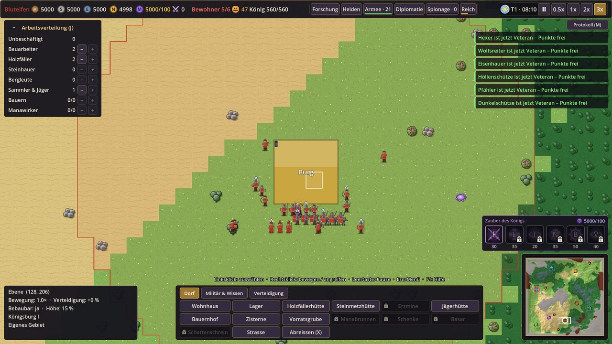

## 6. Bewohner und Berufe

Bewohner arbeiten selbstständig in ihrem Beruf. In der **Arbeitsverteilung** (J) teilst du sie mit „+“ und „−“ zu.

### Bewerber

Neue Bewohner kommen vor allem als **Bewerber**. Alle zwei bis vier Minuten taucht jemand am Rand deines Gebiets auf
und wartet dort zwei Minuten. Jeder Bewerber hat einen Namen, einen **Wunschberuf** und eigene **Bedingungen**:
immer einen freien Wohnplatz, dazu zum Beispiel ein Begrüssungsgeschenk, ein fertiges Gebäude („Ich bin Schmied, ich
komme nur, wenn es eine Schmiede gibt“), eine Mindest-Zufriedenheit, eine Burgstufe, ein ausgebautes Gebäude oder
keine Hungersnot. **Fachleute** arbeiten in ihrem Wunschberuf 20 % schneller, stellen aber strengere Bedingungen.

Klicke auf die Meldung oder den Bewerber selbst: Das **Bewerberfenster** zeigt jede Bedingung mit ✓ oder ✗.
„Aufnehmen“ geht erst, wenn alle erfüllt sind; dann wird der Bewerber dein Bewohner und beginnt gleich in seinem
Wunschberuf (Geschenke werden dabei bezahlt). „Abweisen“ geht immer. Läuft die Zeit ab, zieht er weiter. Alle
wartenden Bewerber stehen auch im **Reichsfenster (L), Reiter „Bewerber“**. Eine **Taverne** lockt mehr Bewerber an,
ausgebaut noch mehr. Höchstens zwei Bewerber warten gleichzeitig. Die Gegner bekommen ihre Bewohner nach denselben
Regeln.

<!-- AUTO:bewerber -->

| Bewerber | Wunschberuf | Bedingungen immer | dazu | ab Burgstufe | Anteil |
|---|---|---|---|---|---|
| **Holzfäller** | Holzfäller | Wohnplatz | +0–1 weitere | 1 | 16,7 % |
| **Beerensammler** | Sammler & Jäger | Wohnplatz | +0–1 weitere | 1 | 16,7 % |
| **Bauer** | Bauern | Wohnplatz, Bauernhof | +1 weitere | 1 | 16,7 % |
| **Steinhauer** | Steinhauer | Wohnplatz | +1–2 weitere | 1 | 11,1 % |
| **Zimmermann** | Bauarbeiter | Wohnplatz | +1–2 weitere | 1 | 11,1 % |
| **Bergmann** | Bergleute | Wohnplatz, Erzmine | +1 weitere | 2 | 11,1 % |
| **Manawirker** | Manawirker | Wohnplatz, Manabrunnen | +1 weitere | 2 | 5,6 % |
| **Schmied** | Bauarbeiter | Wohnplatz, Schmiede | +1 weitere | 3 | 5,6 % |
| **Schankwirt** | Sammler & Jäger | Wohnplatz, Taverne Stufe 2 | +1 weitere | 2 | 5,6 % |

Höchstens 3 Bedingungen je Bewerber (der Wohnplatz zählt mit). Weitere Bedingungen: Geschenk (Nahrung, Holz, Stein), Zufriedenheit 45–55, keine Hungersnot. Fachleute (Chance 25 %, je Tavernenstufe +10 %) arbeiten im Wunschberuf 20 % schneller und ziehen zuerst eine strengere: Geschenk (Nahrung, Holz, Stein, Erz), Zufriedenheit 60–70, Burgstufe 2, 1 Gebäude auf Stufe II. Wartezeit bis zum nächsten Bewerber: 120–240 s, mit Taverne Stufe I/II/III ×0,7 / ×0,55 / ×0,45.

<!-- /AUTO:bewerber -->

Von allein wächst das Volk nur noch selten: etwa alle vier Minuten ein Bewohner, wenn Wohnraum frei ist, mindestens
30 Nahrung im Lager liegt (er kostet 10 Nahrung) und die Bewohner im Schnitt mindestens zufrieden sind (50). Höhere
Burgstufen beschleunigen das ein wenig. Flüchtlinge und Wanderer (Ereignisse) gibt es weiterhin. Neue Bewohner aus dem
natürlichen Zuwachs sind *unbeschäftigt* – gib ihnen Arbeit.

<!-- AUTO:berufe -->

| Beruf | Arbeit | Hinweis, wenn er nichts findet |
|---|---|---|
| **Bauarbeiter** | baut Baustellen, Strassen und repariert (höchstens 4 je Baustelle) | Keine Baustellen vorhanden. |
| **Holzfäller** | sammelt Holz (1 je s) | Keine Bäume in Reichweite – baue eine Holzfällerhütte nahe am Wald. |
| **Steinhauer** | sammelt Stein (0,8 je s) | Keine Steinbrocken in Reichweite – baue eine Steinmetzhütte in ihrer Nähe. |
| **Bergleute** | sammelt Erz (0,6 je s) | Keine Erzadern in Reichweite – baue eine Erzmine in ihrer Nähe. |
| **Sammler & Jäger** | sammelt Nahrung (1 je s) | Keine Beeren oder Wild in Reichweite – baue eine Jägerhütte oder einen Bauernhof. |
| **Bauern** | arbeitet in: Bauernhof | Kein freier Platz – baue einen Bauernhof. |
| **Manawirker** | arbeitet in: Manabrunnen | Kein freier Platz – baue einen Manabrunnen auf einer Manaquelle. |

<!-- /AUTO:berufe -->

- **Hungersnot:** Ist keine Nahrung mehr da, arbeiten alle nur halb so schnell (Bauern und Sammler ausgenommen),
  bis wieder etwas im Lager liegt.
- Wird ein Bewohner angegriffen, flieht er zur Burg und arbeitet danach weiter.
- Ein Befehl (Rechtsklick) unterbricht die Arbeit; „Zur Arbeit“ im Auswahlfenster setzt sie fort.

## 7. Zufriedenheit

Das **Gesicht** oben zeigt den Durchschnitt deiner Bewohner (0–100), der Tooltip die Ursachen. Ein einzelner
Bewohner zeigt seine eigene Zufriedenheit im Auswahlfenster. Alles Weitere steht in der **Reichsübersicht** (L),
Reiter „Zufriedenheit“.

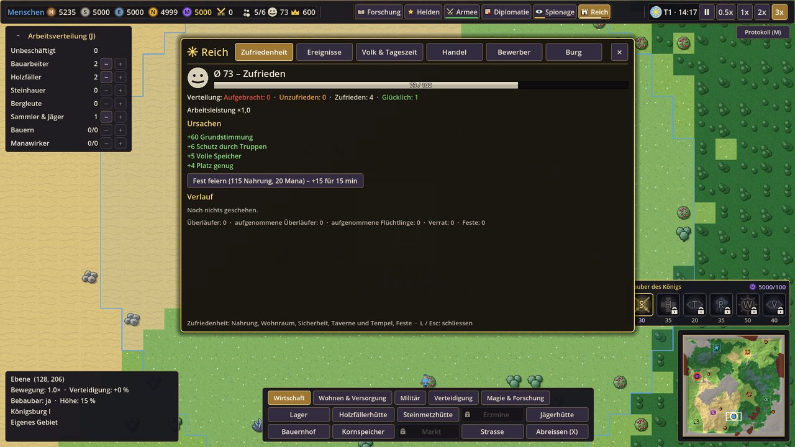

| Hebt die Stimmung | Senkt die Stimmung |
|---|---|
| Grundstimmung 60 | Hunger, wenig Vorrat |
| volle Speicher, freier Wohnraum | Überfüllung (mehr Bewohner als Wohnraum) |
| Truppen im Gebiet, Mauerring und Türme (Sicherheit) | Feinde im Gebiet, Angriffe, verlorene Gebäude, getötete Bewohner |
| **Taverne** (+10 für 20 Bewohner je Taverne), **Tempel** (+8 für 30) | lange ohne Beruf |
| **Fest feiern**: 100 Nahrung + 3 je Bewohner und 20 Mana → +15 für 15 Minuten (danach 40 Minuten Pause) | Ereignisse wie Dürre und Seuche |

| Zufriedenheit | Folge |
|---|---|
| 75–100 *Glücklich* | Arbeit bis +10 % |
| 50–74 *Zufrieden* | normal |
| unter 50 *Unzufrieden* | Arbeitsleistung sinkt (bei 25 nur noch 70 %) |
| unter 25 *Aufgebracht* | Bewohner **laufen über** – sichtbar zu einem Nachbarreich, Dorf oder an den Kartenrand. Ein Befehl hält sie auf |
| unter 20 | **Verrat**: der Gegner erfährt mehr über dich |

## 8. Truppen und Kampf

### Beschwören

Truppen werden in Gebäuden **beschworen**: Gebäude anklicken → Knopf der Einheit im Auswahlfenster (Bild, Kosten;
Dauer, Klasse und Konter im Tooltip). Mehrfach klicken = Warteschlange (höchstens 5); ein Klick auf ein Symbol der
Warteschlange bricht ab und gibt die Kosten zurück. Mit Rechtsklick in die Welt setzt du einen **Sammelpunkt**.
Beschworene Einheiten brauchen Wohnraum, wenn sie arbeiten sollen.

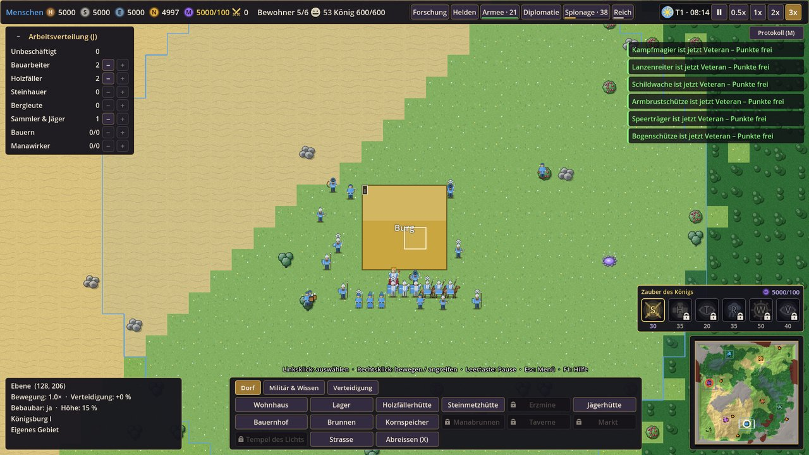

| Gebäude | Einheiten |
|---|---|
| Burg | Späher (GUT) / Kobold (BÖSE); nach Forschung Spione |
| Kaserne | Kämpfer und Schützen; nach Forschung Speerträger, Armbrustschützen, Schildwache, Ritter; Volkskrieger verbündeter Dörfer |
| Reitstall / Wolfszwinger | Reiterei (nach *Ritterorden* / *Schreckensorden*) |
| Magierturm / Hexenturm | Kampfmagier / Hexer (nach *Lichtsegen* / *Fluch der Schwäche*) |
| Krankenstation | Heiler / Blutpriester (nach *Heilkunde* / *Dunkle Heilkunst*) |
| Belagerungswerkstatt / Kriegsschmiede | Rammbock und Katapult (nach *Belagerungskunst* / *Kriegsmaschinen*) |

### Klassen und Konter

Jede Truppe gehört zu einer **Klasse**. Gegen bestimmte Klassen macht sie mehr (oder weniger) Schaden. Kurz:
**Speerträger schlagen Reiter, Reiter überrennen Schützen und Magier, Schützen und Magier zermürben Fusstruppen,
Armbrüste durchschlagen Rüstung, Magier treffen ganze Gruppen.**

<!-- AUTO:konter -->

| Angreifer ↓ / Ziel → | Fusstruppen | Reiterei | Fernkämpfer | Magier | Belagerung | Heiler | Bestien |
|---|---|---|---|---|---|---|---|
| **Fusstruppen** | · | · | · | · | +30 % | · | · |
| **Reiterei** | · | · | +35 % | +35 % | +50 % | +25 % | · |
| **Fernkämpfer** | +10 % | −20 % | · | · | · | · | · |
| **Magier** | +25 % | · | · | · | +25 % | · | +15 % |

<!-- /AUTO:konter -->

Dazu kommt der eigene Zuschlag einzelner Einheiten (Spalte „Besonderheit“ unten), z. B. Speerträger +100 % gegen
Reiterei.

### Alle Truppen

Werte ohne Forschung, Schmiede und Ränge. *Takt* = Sekunden zwischen zwei Angriffen, *Reichweite* in Feldern,
*Tempo* in Feldern pro Sekunde.

<!-- AUTO:truppen -->

**GUT**

| Einheit | Klasse | Gebäude | Forschung | Leben | Angriff | Takt | Reichweite | Rüstung | Tempo | Kosten | Dauer | Besonderheit |
|---|---|---|---|---|---|---|---|---|---|---|---|---|
| **Späher** | Fusstruppen | Königsburg | – | 55 | 4 | 1 s | Nahkampf | 0 % | 3,5 | 20 Nahrung, 3 Mana | 8 s | – |
| **Schwertkämpfer** | Fusstruppen | Kaserne | – | 135 | 13 | 1,2 s | Nahkampf | 22 % | 2 | 30 Holz, 15 Erz, 10 Nahrung, 5 Mana | 15 s | – |
| **Speerträger** | Fusstruppen | Kaserne | Waffenschmiede | 130 | 11 | 1,3 s | Nahkampf | 20 % | 2 | 35 Holz, 10 Erz, 10 Nahrung, 5 Mana | 16 s | +100 % gegen Reiterei |
| **Bogenschütze** | Fernkämpfer | Kaserne | – | 78 | 10 | 1,5 s | 5 | 6 % | 2,1 | 40 Holz, 10 Nahrung, 5 Mana | 15 s | gegen Gebäude ×0,5 |
| **Armbrustschütze** | Fernkämpfer | Kaserne | Waffenschmiede | 90 | 19 | 2,4 s | 6 | 12 % | 1,9 | 40 Holz, 25 Erz, 10 Nahrung, 8 Mana | 20 s | +20 % gegen Reiterei, ignoriert 50 % Rüstung, gegen Gebäude ×0,6 |
| **Schildwache** | Fusstruppen | Kaserne | Schildwall | 250 | 15 | 1,4 s | Nahkampf | 45 % | 1,6 | 20 Holz, 40 Erz, 20 Nahrung, 10 Mana | 24 s | +20 % gegen Fusstruppen |
| **Ritter** | Fusstruppen | Kaserne | Ritterorden | 285 | 26 | 1,3 s | Nahkampf | 36 % | 2,4 | 40 Erz, 30 Nahrung, 20 Mana | 28 s | – |
| **Lanzenreiter** | Reiterei | Reitstall | Ritterorden | 210 | 18 | 1,3 s | Nahkampf | 25 % | 3,6 | 30 Holz, 15 Erz, 50 Nahrung, 15 Mana | 26 s | – |
| **Kampfmagier** | Magier | Magierturm | Lichtsegen | 80 | 16 | 2,6 s | 5,5 | 5 % | 2 | 25 Holz, 30 Nahrung, 30 Mana | 26 s | Flächenschaden (1,1 Felder), gegen Gebäude ×0,8 |
| **Heiler** | Heiler | Krankenstation | – | 66 | – | – | – | 0 % | 2 | 30 Nahrung, 12 Mana | 18 s | heilt 7/s |
| **Kundschafterin** | Zivil | Königsburg, Kundschafterhaus | Kundschafter | 70 | – | – | – | 5 % | 3,2 | 20 Erz, 40 Nahrung, 25 Mana | 30 s | immer getarnt |
| **Rammbock** | Belagerung | Belagerungswerkstatt | Belagerungskunst | 450 | 50 | 3,5 s | Nahkampf | 45 % | 1,1 | 120 Holz, 30 Erz, 10 Mana | 40 s | greift nur Gebäude an, gegen Gebäude ×3,5 |
| **Katapult** | Belagerung | Belagerungswerkstatt | Belagerungskunst | 220 | 40 | 5 s | 9 | 10 % | 1 | 160 Holz, 60 Stein, 40 Erz, 15 Mana | 50 s | Flächenschaden (1,2 Felder), gegen Gebäude ×2,5 |

**BÖSE**

| Einheit | Klasse | Gebäude | Forschung | Leben | Angriff | Takt | Reichweite | Rüstung | Tempo | Kosten | Dauer | Besonderheit |
|---|---|---|---|---|---|---|---|---|---|---|---|---|
| **Kobold** | Fusstruppen | Königsburg | – | 45 | 5 | 1 s | Nahkampf | 0 % | 3,8 | 20 Nahrung, 3 Mana | 8 s | – |
| **Schattenkrieger** | Fusstruppen | Kaserne | – | 122 | 15 | 1,2 s | Nahkampf | 22 % | 2 | 30 Holz, 15 Erz, 10 Nahrung, 5 Mana | 15 s | – |
| **Pfähler** | Fusstruppen | Kaserne | Schwarze Klingen | 120 | 12 | 1,3 s | Nahkampf | 20 % | 2 | 35 Holz, 10 Erz, 10 Nahrung, 5 Mana | 16 s | +100 % gegen Reiterei |
| **Dunkelschütze** | Fernkämpfer | Kaserne | – | 72 | 11 | 1,5 s | 5 | 6 % | 2,1 | 40 Holz, 10 Nahrung, 5 Mana | 15 s | gegen Gebäude ×0,5 |
| **Höllenschütze** | Fernkämpfer | Kaserne | Schwarze Klingen | 85 | 20 | 2,4 s | 6 | 10 % | 1,9 | 40 Holz, 25 Erz, 10 Nahrung, 8 Mana | 20 s | +20 % gegen Reiterei, ignoriert 50 % Rüstung, gegen Gebäude ×0,6 |
| **Eisenhauer** | Fusstruppen | Kaserne | Dornenpanzer | 235 | 17 | 1,4 s | Nahkampf | 42 % | 1,6 | 20 Holz, 40 Erz, 20 Nahrung, 10 Mana | 24 s | +20 % gegen Fusstruppen |
| **Schreckensritter** | Fusstruppen | Kaserne | Schreckensorden | 265 | 29 | 1,3 s | Nahkampf | 36 % | 2,4 | 40 Erz, 30 Nahrung, 20 Mana | 28 s | – |
| **Wolfsreiter** | Reiterei | Wolfszwinger | Schreckensorden | 190 | 19 | 1,2 s | Nahkampf | 20 % | 3,9 | 30 Holz, 12 Erz, 55 Nahrung, 15 Mana | 26 s | – |
| **Hexer** | Magier | Hexenturm | Fluch der Schwäche | 75 | 18 | 2,6 s | 5,5 | 5 % | 2 | 25 Holz, 30 Nahrung, 30 Mana | 26 s | Flächenschaden (1,1 Felder), gegen Gebäude ×0,8 |
| **Blutpriester** | Heiler | Krankenstation | – | 66 | – | – | – | 0 % | 2 | 30 Nahrung, 12 Mana | 18 s | heilt 7/s |
| **Schattenspion** | Zivil | Königsburg, Schattenloge | Spitzel | 65 | – | – | – | 5 % | 3,3 | 20 Erz, 40 Nahrung, 25 Mana | 30 s | immer getarnt |
| **Sturmbock** | Belagerung | Kriegsschmiede | Kriegsmaschinen | 420 | 55 | 3,5 s | Nahkampf | 45 % | 1,1 | 120 Holz, 30 Erz, 10 Mana | 40 s | greift nur Gebäude an, gegen Gebäude ×3,5 |
| **Schädelschleuder** | Belagerung | Kriegsschmiede | Kriegsmaschinen | 210 | 38 | 5 s | 9,5 | 10 % | 1 | 160 Holz, 60 Stein, 40 Erz, 15 Mana | 50 s | Flächenschaden (1,3 Felder), gegen Gebäude ×2,5 |

**Volkskrieger** (Kaserne, nach Bündnis mit oder Aufnahme eines Dorfs dieses Volks)

| Einheit | Volk | Klasse | Leben | Angriff | Reichweite | Rüstung | Tempo | Kosten | Besonderheit |
|---|---|---|---|---|---|---|---|---|---|
| **Eisenwache** | Zwerge | Fusstruppen | 300 | 20 | Nahkampf | 45 % | 1,8 | 50 Erz, 30 Nahrung, 10 Mana | – |
| **Schleudermeister** | Halblinge | Fernkämpfer | 70 | 11 | 5,5 | 5 % | 2,6 | 30 Holz, 30 Nahrung, 5 Mana | gegen Gebäude ×0,5 |
| **Blattschütze** | Waldelfen | Fernkämpfer | 90 | 15 | 7 | 5 % | 2,4 | 50 Holz, 20 Nahrung, 15 Mana | gegen Gebäude ×0,5 |
| **Sumpfjäger** | Echsenvolk | Fusstruppen | 150 | 16 | Nahkampf | 15 % | 2,8 | 15 Erz, 40 Nahrung, 10 Mana | – |
| **Steppenreiter** | Nomaden | Reiterei | 170 | 17 | Nahkampf | 20 % | 3,4 | 20 Holz, 20 Erz, 40 Nahrung, 10 Mana | – |
| **Hügelriese** | Riesen | Fusstruppen | 650 | 38 | Nahkampf | 30 % | 1,6 | 60 Stein, 30 Erz, 80 Nahrung, 25 Mana | gegen Gebäude ×2,5 |
| **Quellgeist** | Wassergeister | Heiler | 80 | – | – | 10 % | 2,3 | 20 Nahrung, 25 Mana | heilt 9/s |
| **Koboldsprenger** | Koboldhändler | Fernkämpfer | 60 | 20 | 5 | 5 % | 2,3 | 30 Erz, 20 Nahrung, 10 Mana | gegen Gebäude ×2,5 |

<!-- /AUTO:truppen -->

### Kampfregeln

- **Heimvorteil:** im eigenen Gebiet +15 % Kampfkraft.
- **Gelände:** Wald und Berge schützen (+20 % bzw. +30 % Verteidigung), Sumpf und Wüste schwächen. Dazu kommen die
  Geländeboni deines Volks.
- **Erholung:** Verletzte heilen sich nach ein paar Sekunden ohne Kampf. Krankenstation (Heilkreis) und Heiler
  heilen schneller, „Rückzug zur Burg“ deutlich schneller. Weit weg vom eigenen Gebiet erholen sich Truppen nicht
  (siehe [Versorgung](#versorgung)).
- **Der König** verteidigt die Burg, verlässt aber nie das eigene Gebiet und flieht verletzt in die Burg.
- Besiegte Monster und zerstörte Höhlen geben **Beute** und **Kampfpunkte**.

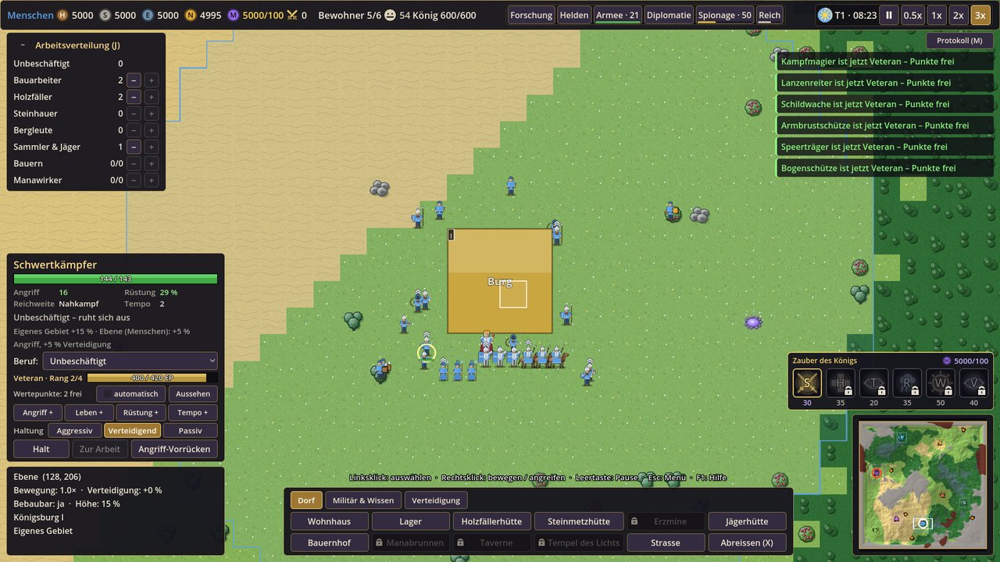

## 9. Ränge, Wertepunkte und Aussehen

Truppen sammeln im Kampf **Erfahrung (EP)** und steigen auf. Der Rang steht als Winkel über dem Kopf (Soldat ein
silberner, Veteran zwei, Elite drei goldene, Held der Truppe ein Stern) und im Auswahlfenster mit Erfahrungsbalken.

<!-- AUTO:raenge -->

| Rang | nötige EP | Wertepunkte beim Aufstieg |
|---|---|---|
| **Rekrut** | 0 | 0 |
| **Soldat** | 60 | 1 |
| **Veteran** | 180 | 1 |
| **Elite** | 420 | 2 |
| **Held der Truppe** | 900 | 2 |

| Knopf | Wirkung |
|---|---|
| **Angriff +** | +6 % je Punkt |
| **Leben +** | +8 % je Punkt |
| **Rüstung +** | +3 Prozentpunkte je Punkt |
| **Tempo +** | +4 % je Punkt |

Höchstens 4 Punkte je Wert. Jeder Rang gibt ausserdem +3 % Leben und +3 % Angriff; beim Aufstieg heilt die Truppe 25 % ihres Lebens. EP gibt es je Schadenspunkt (0,25 EP) und für den letzten Treffer (8 EP + 4 EP je Kampfpunkt des Opfers). Helden bekommen ab Stufe 2 je Stufe einen Wertepunkt.

<!-- /AUTO:raenge -->

**Wertepunkte verteilen:** Truppe anklicken → „Angriff +“, „Leben +“, „Rüstung +“ oder „Tempo +“ (die Knöpfe
erscheinen nur, solange Punkte frei sind). Mehrere Truppen auswählen → „Verteilen“ verteilt für alle nach ihrer
Klasse. Das Häkchen **„automatisch“** lässt dein Reich neue Punkte bei jedem Aufstieg selbst verteilen.

**Aussehen (Skins):** Truppe anklicken → „Aussehen“ → „Alle: …“ färbt alle Einheiten dieses Typs um, „Diese: …“ nur
die eine. Rein kosmetisch; die Beschwören-Knöpfe zeigen das gewählte Aussehen.

<!-- AUTO:skins -->

| Aussehen | id (Dateiname) | Fraktion | Beschreibung |
|---|---|---|---|
| **Standard** | `standard` | alle | Farben des Reichs. |
| **Königsgarde** | `royal` | GUT | Blau und Gold der königlichen Garde. |
| **Sonnenwacht** | `sunwatch` | GUT | Helle Wappenröcke mit Sonnenzeichen. |
| **Schattenwache** | `shadow` | BÖSE | Schwarze Umhänge mit violettem Saum. |
| **Blutbanner** | `blood` | BÖSE | Rote Banner der Blutkrieger. |
| **Heldenbanner** | `hero_banner` | alle | Nur für einzelne Einheiten ab dem Rang Elite: goldenes Banner verdienter Krieger. |

<!-- /AUTO:skins -->

## 10. Schmiede

Die **Schmiede** (BÖSE: Blutschmiede; braucht eine Kaserne, eine je Reich) verbessert Waffen und Rüstung **je
Truppenklasse** in drei Stufen. Schmiede anklicken → „Waffen x/3“ bzw. „Rüstung x/3“; Kosten und Wirkung stehen im
Tooltip, die Wirkung danach im Tooltip der Kampfwerte jeder Truppe.

<!-- AUTO:schmiede -->

| Verbesserung | Name GUT / BÖSE | Wirkung | Stufe 1 | Stufe 2 | Stufe 3 |
|---|---|---|---|---|---|
| **Waffen der Fusstruppen** | Stahlklingen / Schwarzstahl | +10 % Angriff je Stufe | 20 Holz, 40 Erz | 30 Holz, 80 Erz, 15 Mana | 40 Holz, 140 Erz, 35 Mana |
| **Rüstung der Fusstruppen** | Kettenhemden / Dornenpanzer | +12 % Rüstung, +5 % Leben je Stufe | 20 Stein, 45 Erz | 30 Stein, 90 Erz, 15 Mana | 40 Stein, 150 Erz, 35 Mana |
| **Waffen der Reiterei** | Turnierlanzen / Wolfsklingen | +10 % Angriff je Stufe | 30 Holz, 50 Erz | 40 Holz, 90 Erz, 20 Mana | 50 Holz, 150 Erz, 40 Mana |
| **Rüstung der Reiterei** | Rossharnisch / Wolfspanzer | +12 % Rüstung, +5 % Leben je Stufe | 20 Stein, 50 Erz | 30 Stein, 95 Erz, 20 Mana | 40 Stein, 160 Erz, 40 Mana |
| **Geschosse der Fernkämpfer** | Gefiederte Pfeile / Widerhakenbolzen | +10 % Angriff je Stufe | 50 Holz, 20 Erz | 80 Holz, 40 Erz, 15 Mana | 120 Holz, 70 Erz, 35 Mana |
| **Rüstung der Fernkämpfer** | Lederwämser / Schattenleder | +15 % Rüstung, +6 % Leben je Stufe | 30 Holz, 30 Erz | 50 Holz, 60 Erz, 15 Mana | 70 Holz, 100 Erz, 35 Mana |
| **Stäbe der Magier** | Sternenstäbe / Knochenstäbe | +10 % Angriff je Stufe | 30 Holz, 40 Mana | 40 Holz, 30 Erz, 70 Mana | 60 Holz, 50 Erz, 110 Mana |
| **Schutz der Magier** | Schutzrunen / Blutsiegel | +10 % Rüstung, +8 % Leben je Stufe | 30 Stein, 35 Mana | 50 Stein, 30 Erz, 60 Mana | 70 Stein, 50 Erz, 100 Mana |
| **Beschläge der Belagerungswaffen** | Eisenbeschläge / Dornenbeschläge | +10 % Rüstung, +10 % Leben je Stufe | 60 Holz, 40 Erz | 90 Holz, 70 Erz, 20 Mana | 120 Holz, 110 Erz, 40 Mana |

<!-- /AUTO:schmiede -->

## 11. Befehle, Armeen und Haltungen

### Auswählen und befehlen

- **Auswählen:** Linksklick; Rahmen ziehen wählt eigene Truppen (Bewohner nur, wenn keine Truppen im Rahmen sind);
  Doppelklick wählt alle dieses Typs im Bild; **Strg + A** wählt alle Krieger (ohne Bewohner und König).
- **Bewegen / Angreifen:** Rechtsklick ins Gelände bzw. auf einen Feind.
- **Angreifend vorrücken:** Strg + Rechtsklick – die Gruppe kämpft unterwegs gegen alles, was ihr begegnet.
- **Armeen 1–9:** Strg + Zahl speichert die Auswahl, Umschalt + Zahl ergänzt, die Zahl wählt, zweimal drücken
  springt hin. Helden sind Teil von Armeen; marschiert eine Armee mit Held, führt er sie an.
- **Formation** (F oder Knopf): Block, Linie, Keil, Kreis.

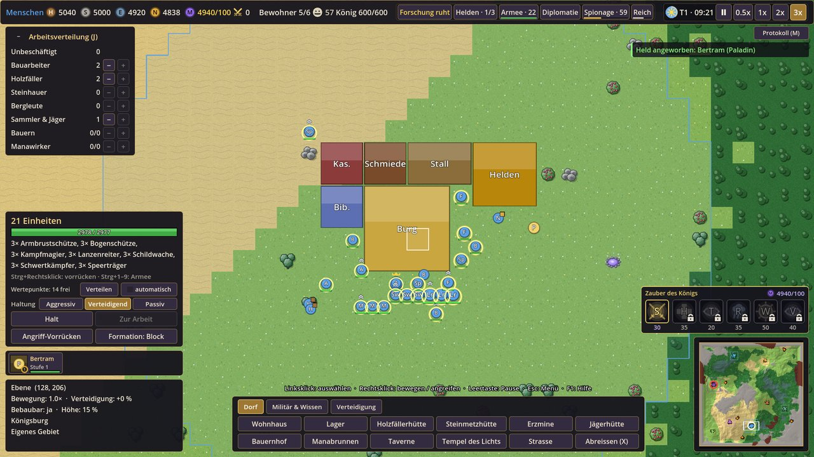

### Haltungen

Die Haltung bestimmt, wie selbstständig Truppen kämpfen (Zeile „Haltung“ im Auswahlfenster oder im Armeefenster).
Angriffsbefehle gelten in jeder Haltung.

| Haltung | Verhalten |
|---|---|
| **Aggressiv** | greift Feinde in Sichtweite an und verfolgt sie weit, auch vom Posten weg |
| **Verteidigend** (Standard) | greift an, kehrt nach kurzer Verfolgung auf den Posten zurück |
| **Passiv** | greift nie von selbst an – nur auf Befehl |

### Armeefenster (T)

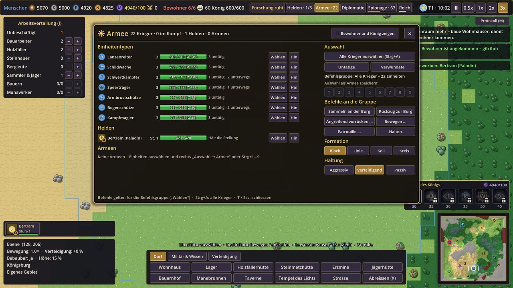

**T** oder der Knopf „Armee · 22“ oben öffnet die Übersicht aller Krieger:

- **Links:** je Einheitentyp Anzahl, Lebensbalken („gesamt / Höchstwert (Ø …)“) und was sie tun (untätig, im Kampf,
  unterwegs, bei der Arbeit); darunter die Helden und die Armeen 1–9 mit Stärke, Ort und Befehl. „Wählen“ macht eine
  Zeile zur **Befehlsgruppe**, „Hin“ springt hin, „✕“ löst eine Armee auf. „Bewohner und König zeigen“ nimmt sie dazu.
- **Rechts – Auswahl:** alle Krieger (Strg + A), Untätige, Verwundete (unter 70 % Leben), Auswahl als Armee 1–9
  speichern.
- **Rechts – Befehle an die Gruppe:** *Sammeln an der Burg* (Marsch in Formation), *Rückzug zur Burg* (läuft ohne zu
  kämpfen hin und erholt sich dort schneller), *Angreifend vorrücken …*, *Bewegen …*, *Patrouille …* (nach dem
  Knopf ein Ziel auf der Karte anklicken; Esc bricht ab), *Halten*, **Formation** und **Haltung**.

## 12. Helden

Helden sind starke Einzelkämpfer, die mit der Zeit aufsteigen, Fähigkeiten haben und Armeen anführen.

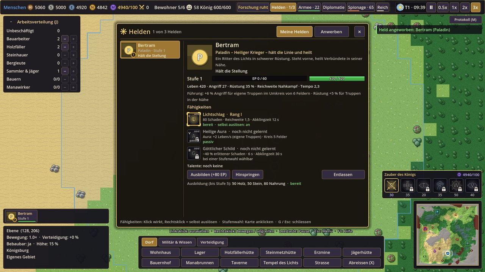

1. **Heldenhalle** bauen (BÖSE: *Halle der Schatten*; braucht eine Kaserne, eine je Reich).
2. **G** oder Knopf „Helden“ → Reiter „Anwerben“ (oder die Halle anklicken). Jeder Heldentyp einmal, höchstens drei
   Helden. Der erste kostet 150 Nahrung, 80 Erz und 60 Mana, jeder weitere 100 Nahrung, 40 Erz und 15 Mana mehr.
3. Der Held erscheint in der **Heldenleiste** links (Klick wählt, Doppelklick springt hin, Rechtsklick öffnet das
   Heldenfenster).
4. **Fähigkeiten:** C / V / B oder die Knöpfe im Auswahlfenster – auch wenn er mit seiner Armee ausgewählt ist (Tab
   wechselt den Helden). Fähigkeiten mit Ziel: Feind bzw. Stelle anklicken. Rechtsklick auf einen Fähigkeitsknopf
   schaltet „selbst auslösen“ um (goldener Rahmen).
5. **Führung:** eigene Truppen in der Nähe (6 Felder) schlagen härter zu (+5 %, +1 % je Stufe), dazu hat jeder Held
   eine eigene Führungseigenschaft.
6. **Erfahrung:** besiegte Feinde in der Nähe (mehrere Helden teilen sich die EP), zerstörte Höhlen zählen
   1,5-fach. In der Halle lässt sich ein Held **ausbilden** (80 Nahrung, 50 Holz, 50 Stein für 80 EP, bis Stufe 5;
   mit der Forschung *Heldenlehre* bis 7). Bei jedem Stufenaufstieg wählst du zwischen einer Fähigkeitsstufe (I–III)
   und einem Talent, ab Stufe 2 gibt es dazu einen Wertepunkt.
7. **Tod:** Ein gefallener Held kann nach 60 Sekunden in der Burg **wiederbelebt** werden (Burg anklicken,
   Heldenleiste oder Heldenfenster) – gegen Kosten, mit gleicher Stufe, und er ist wieder in seiner Armee.

<!-- AUTO:helden -->

| Held | Fraktion | Rolle | Leben / Angriff | Führung | Fähigkeiten (C / V / B) |
|---|---|---|---|---|---|
| **Paladin** | GUT | Heiliger Krieger – hält die Linie und heilt | 420 / 26 | Rüstung +5 % für Truppen in der Nähe | **Lichtschlag** – Ein Schlag aus reinem Licht trifft einen Feind. **Heilige Aura** – Eigene Truppen in der Nähe heilen sich ständig. **Göttlicher Schild** – Der Paladin nimmt eine Weile viel weniger Schaden. |
| **Sternenmagierin** | GUT | Magierin – Flächenschaden aus der Ferne | 340 / 24 | Erholung +1 Leben/s für Truppen in der Nähe | **Sternenfeuer** – Sternenfeuer fällt auf alle Feinde im Kreis. **Sternensprung** – Die Magierin springt an eine freie Stelle in Reichweite. **Sternenquelle** – Solange die Magierin lebt, fasst das Reich mehr Mana und die Burg erzeugt Mana. |
| **Waldläuferin** | GUT | Bogenschützin – schnell, weitsichtig, treibt an | 360 / 22 | Tempo +10 % für Truppen in der Nähe | **Pfeilhagel** – Ein Pfeilhagel trifft alle Feinde im Kreis und bremst sie. **Schlachtruf** – Eigene Truppen in der Nähe greifen eine Weile schneller an. **Adlerauge** – Mehr Reichweite und Sicht. |
| **Nekromant** | BÖSE | Totenbeschwörer – Seelenblitze und Skelette | 360 / 24 | Feinde in der Nähe −5 % Angriff | **Seelenblitz** – Ein Blitz aus gestohlenen Seelen trifft einen Feind. **Totenerweckung** – Skelette erheben sich und kämpfen eine halbe Minute lang. **Fluchaura** – Feinde in der Nähe sind schlechter geschützt. |
| **Kriegsherr** | BÖSE | Orkhäuptling – Nahkampf, Kriegsschrei | 460 / 30 | Zusätzlich +5 % Angriff für Truppen in der Nähe | **Wirbelwind** – Der Kriegsherr wirbelt herum und trifft alle Feinde um sich. **Kriegsschrei** – Eigene Truppen in der Nähe schlagen eine Weile härter zu. **Blutzoll** – Ein Teil des ausgeteilten Schadens heilt den Kriegsherrn. |
| **Klingentänzerin** | BÖSE | Blutelfen-Assassine – springt, vergiftet | 300 / 28 | Truppen in der Nähe bemerken Feinde 1 Feld früher | **Schattenschritt** – Springt neben einen Feind und trifft ihn. **Giftklinge** – Vergiftet einen Feind: er verliert eine Weile Leben. **Ausweichen** – Die Klingentänzerin weicht Schlägen aus: mehr Rüstung. |

<!-- /AUTO:helden -->

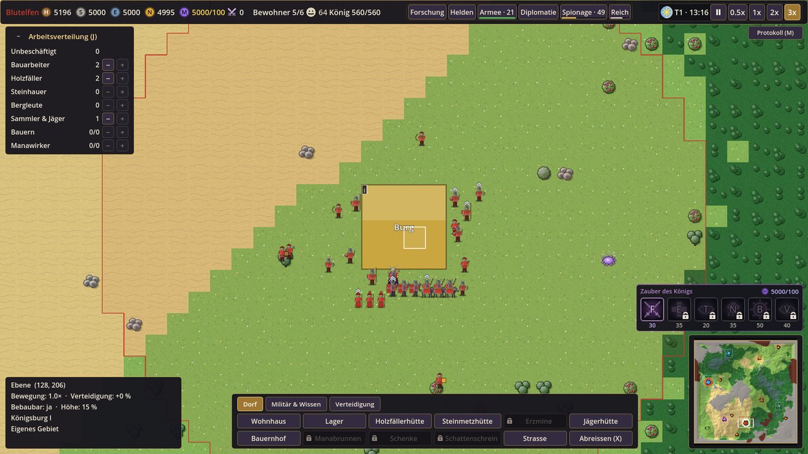

## 13. Forschung, Mana und Zauber

### Forschung

Forschen braucht eine **Bibliothek** (BÖSE: *Dunkles Archiv*). **R** oder Knopf „Forschung“ öffnet den
Forschungsbaum mit vier Zweigen (Militär, Magie, Wirtschaft, Mana) in vier Stufen. Klick auf eine Forschung bezahlt
sie und reiht sie ein (bis zu drei); Klick auf eine laufende bricht sie ab (zweiter Klick bestätigt, volle
Erstattung). Eine zweite Bibliothek forscht 25 % schneller. Steht keine Forschung an, zeigt der Knopf gelb
„Forschung ruht“.

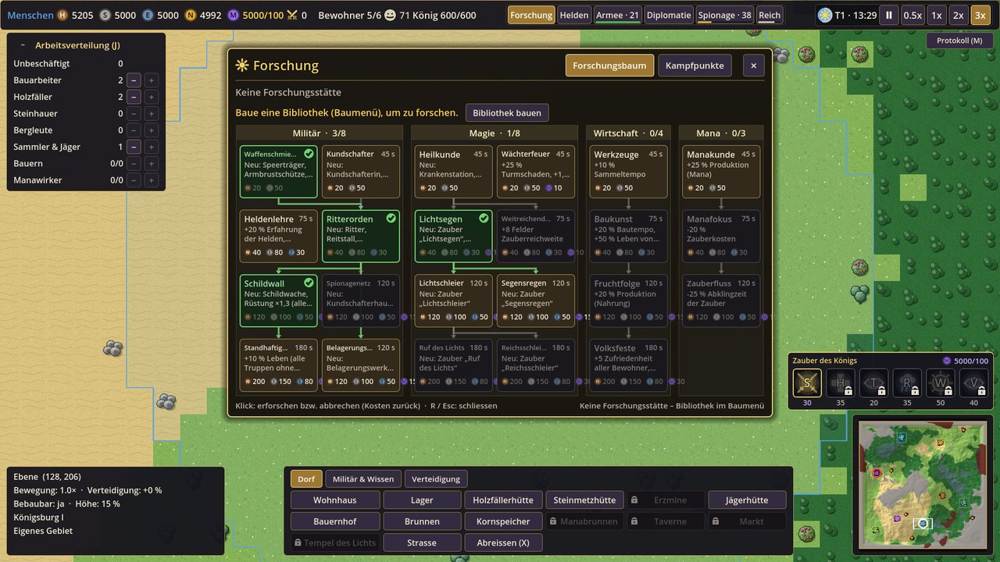

<!-- AUTO:forschung -->

**GUT**

| Zweig | Stufe | Forschung | Wirkung | braucht | Kosten | Dauer |
|---|---|---|---|---|---|---|
| Militär | 1 | **Kundschafter** | Der König kann in der Burg Kundschafterinnen beschwören: getarnte Spione, die fremde Reiche auskundschaften und Dörfer aufwiegeln. | – | 20 Holz, 50 Stein | 45 s |
| Militär | 1 | **Waffenschmiede** | Bessere Klingen und Bögen: Schwertkämpfer und Bogenschützen +10 % Angriff. Schaltet Speerträger und Armbrustschützen in der Kaserne frei. | – | 20 Holz, 50 Stein | 45 s |
| Militär | 2 | **Heldenlehre** | Helden lernen schneller (+20 % Erfahrung) und können in der Heldenhalle bis Stufe 7 ausgebildet werden. | – | 40 Holz, 80 Stein, 30 Erz | 75 s |
| Militär | 2 | **Ritterorden** | Schaltet den Ritter in der Kaserne sowie den Reitstall mit Lanzenreitern frei. | Waffenschmiede | 40 Holz, 80 Stein, 30 Erz | 75 s |
| Militär | 3 | **Schildwall** | Rüstung aller Truppen ×1,3 – Schwertkämpfer 22 % → 29 %, Ritter 36 % → 47 %. Schaltet die Schildwache (schwere Fusstruppe) in der Kaserne frei. | Ritterorden | 120 Holz, 100 Stein, 50 Erz, 15 Mana | 120 s |
| Militär | 3 | **Spionagenetz** | Schaltet das Kundschafterhaus frei. Spione sind geschickter (schwerer zu entdecken), fremde Spione fallen eher auf. | Kundschafter | 120 Holz, 100 Stein, 50 Erz, 15 Mana | 120 s |
| Militär | 4 | **Belagerungskunst** | Schaltet die Belagerungswerkstatt frei: Rammböcke brechen Tore und Mauern, Katapulte beschiessen Befestigungen aus sicherer Entfernung. | Ritterorden | 120 Holz, 100 Stein, 50 Erz, 15 Mana | 120 s |
| Militär | 4 | **Standhaftigkeit** | Alle Truppen haben 10 % mehr Lebenspunkte. | Schildwall | 200 Holz, 150 Stein, 80 Erz, 30 Mana | 180 s |
| Magie | 1 | **Heilkunde** | Schaltet die Krankenstation und den Zauber „Heilendes Licht“ frei. | – | 20 Holz, 50 Stein | 45 s |
| Magie | 1 | **Wächterfeuer** | Feuerkörbe auf den Türmen: +25 % Turmschaden, +1,5 Felder Reichweite, fremde Spione fallen eher auf. | – | 20 Holz, 50 Stein, 10 Mana | 45 s |
| Magie | 2 | **Lichtsegen** | Der König lernt den Zauber „Lichtsegen“: eigene Truppen kämpfen stärker. Schaltet den Magierturm mit Kampfmagiern frei. | Heilkunde | 40 Holz, 80 Stein, 30 Erz, 10 Mana | 75 s |
| Magie | 2 | **Weitreichende Magie** | Der König kann 8 Felder weiter ausserhalb des eigenen Gebiets zaubern. | Heilkunde | 40 Holz, 80 Stein, 30 Erz, 10 Mana | 75 s |
| Magie | 3 | **Lichtschleier** | Der König lernt, Truppen mit Licht zu verbergen. | Lichtsegen | 120 Holz, 100 Stein, 50 Erz, 15 Mana | 120 s |
| Magie | 3 | **Segensregen** | Der König lernt, segensreichen Regen zu rufen. | Lichtsegen | 120 Holz, 100 Stein, 50 Erz, 15 Mana | 120 s |
| Magie | 4 | **Reichsschleier** | Der König lernt, sein ganzes Reich zu verschleiern: der Entdeckungswert sinkt um 40 %, solange laufend Mana fliesst. | Lichtschleier | 200 Holz, 150 Stein, 80 Erz, 30 Mana | 180 s |
| Magie | 4 | **Ruf des Lichts** | Der König kann Lichtgeister herbeirufen. | Lichtschleier | 200 Holz, 150 Stein, 80 Erz, 30 Mana | 180 s |
| Wirtschaft | 1 | **Werkzeuge** | Bewohner sammeln 10 % schneller. | – | 20 Holz, 50 Stein | 45 s |
| Wirtschaft | 2 | **Baukunst** | Gebäude und Strassen entstehen 20 % schneller. Steinmauern: Mauern, Tore und Türme +50 % Leben. | Werkzeuge | 40 Holz, 80 Stein, 30 Erz | 75 s |
| Wirtschaft | 3 | **Fruchtfolge** | Bauernhöfe liefern 20 % mehr Nahrung. | Baukunst | 120 Holz, 100 Stein, 50 Erz, 15 Mana | 120 s |
| Wirtschaft | 4 | **Volksfeste** | Feiern stärken das Reich: +5 Zufriedenheit aller Bewohner, Feste kosten 30 % weniger. | Fruchtfolge | 200 Holz, 150 Stein, 80 Erz, 30 Mana | 180 s |
| Mana | 1 | **Manakunde** | Manabrunnen liefern 25 % mehr Mana. | – | 20 Holz, 50 Stein | 45 s |
| Mana | 2 | **Manafokus** | Alle Zauber kosten 20 % weniger Mana. | Manakunde | 40 Holz, 80 Stein, 30 Erz | 75 s |
| Mana | 3 | **Zauberfluss** | Alle Zauber sind 25 % schneller wieder bereit. | Manafokus | 120 Holz, 100 Stein, 50 Erz, 15 Mana | 120 s |

**BÖSE**

| Zweig | Stufe | Forschung | Wirkung | braucht | Kosten | Dauer |
|---|---|---|---|---|---|---|
| Militär | 1 | **Schwarze Klingen** | Gehärtete dunkle Waffen: Schattenkrieger und Dunkelschützen +10 % Angriff. Schaltet Pfähler und Höllenschützen in der Kaserne frei. | – | 20 Holz, 50 Stein | 45 s |
| Militär | 1 | **Spitzel** | Der König kann in der Burg Schattenspione beschwören: getarnte Spione, die fremde Reiche ausspähen und Dörfer aufhetzen. | – | 20 Holz, 50 Stein | 45 s |
| Militär | 2 | **Heldenlehre** | Helden lernen schneller (+20 % Erfahrung) und können in der Heldenhalle bis Stufe 7 ausgebildet werden. | – | 40 Holz, 80 Stein, 30 Erz | 75 s |
| Militär | 2 | **Schreckensorden** | Schaltet den Schreckensritter in der Kaserne sowie den Wolfszwinger mit Wolfsreitern frei. | Schwarze Klingen | 40 Holz, 80 Stein, 30 Erz | 75 s |
| Militär | 3 | **Dornenpanzer** | Rüstung aller Truppen ×1,3 – Schattenkrieger 22 % → 29 %, Schreckensritter 36 % → 47 %. Schaltet den Eisenhauer (schwere Fusstruppe) in der Kaserne frei. | Schreckensorden | 120 Holz, 100 Stein, 50 Erz, 15 Mana | 120 s |
| Militär | 3 | **Schattennetz** | Schaltet die Schattenloge frei. Spione sind geschickter (schwerer zu entdecken), fremde Spione fallen eher auf. | Spitzel | 120 Holz, 100 Stein, 50 Erz, 15 Mana | 120 s |
| Militär | 4 | **Blutrausch** | Alle Truppen schlagen 11 % schneller zu (10 % kürzere Pause zwischen Angriffen). | Dornenpanzer | 200 Holz, 150 Stein, 80 Erz, 30 Mana | 180 s |
| Militär | 4 | **Kriegsmaschinen** | Schaltet die Kriegsschmiede frei: Sturmböcke brechen Tore und Mauern, Schädelschleudern beschiessen Befestigungen aus sicherer Entfernung. | Schreckensorden | 120 Holz, 100 Stein, 50 Erz, 15 Mana | 120 s |
| Magie | 1 | **Dunkle Heilkunst** | Schaltet die Krankenstation und den Zauber „Dunkle Erneuerung“ frei. | – | 20 Holz, 50 Stein | 45 s |
| Magie | 1 | **Späherauge** | Glühende Augen auf den Türmen: +25 % Turmschaden, +1,5 Felder Reichweite, fremde Spione fallen eher auf. | – | 20 Holz, 50 Stein, 10 Mana | 45 s |
| Magie | 2 | **Fluch der Schwäche** | Der König lernt den Fluch „Fluch der Schwäche“: Feinde schlagen schwächer zu. Schaltet den Hexenturm mit Hexern frei. | Dunkle Heilkunst | 40 Holz, 80 Stein, 30 Erz, 10 Mana | 75 s |
| Magie | 2 | **Lange Schatten** | Der König kann 8 Felder weiter ausserhalb des eigenen Gebiets zaubern. | Dunkle Heilkunst | 40 Holz, 80 Stein, 30 Erz, 10 Mana | 75 s |
| Magie | 3 | **Finsterer Nebel** | Der König lernt, lähmenden Nebel zu rufen. | Fluch der Schwäche | 120 Holz, 100 Stein, 50 Erz, 15 Mana | 120 s |
| Magie | 3 | **Schattenmantel** | Der König lernt, Truppen in Schatten zu hüllen. | Fluch der Schwäche | 120 Holz, 100 Stein, 50 Erz, 15 Mana | 120 s |
| Magie | 4 | **Reichsschatten** | Der König lernt, sein ganzes Reich in Schatten zu hüllen: der Entdeckungswert sinkt um 40 %, solange laufend Mana fliesst. | Schattenmantel | 200 Holz, 150 Stein, 80 Erz, 30 Mana | 180 s |
| Magie | 4 | **Schattenbrut** | Der König kann Schattendiener beschwören. | Schattenmantel | 200 Holz, 150 Stein, 80 Erz, 30 Mana | 180 s |
| Wirtschaft | 1 | **Harte Hand** | Bewohner sammeln 10 % schneller. | – | 20 Holz, 50 Stein | 45 s |
| Wirtschaft | 2 | **Dunkle Baukunst** | Gebäude und Strassen entstehen 20 % schneller. Steinmauern: Mauern, Tore und Türme +50 % Leben. | Harte Hand | 40 Holz, 80 Stein, 30 Erz | 75 s |
| Wirtschaft | 3 | **Schattenfelder** | Bauernhöfe liefern 20 % mehr Nahrung. | Dunkle Baukunst | 120 Holz, 100 Stein, 50 Erz, 15 Mana | 120 s |
| Wirtschaft | 4 | **Eiserne Hand** | Wer zweifelt, schweigt: Überlaufen und Verrat −40 %, +2 Zufriedenheit. | Schattenfelder | 200 Holz, 150 Stein, 80 Erz, 30 Mana | 180 s |
| Mana | 1 | **Seelenmana** | Manabrunnen liefern 25 % mehr Mana. | – | 20 Holz, 50 Stein | 45 s |
| Mana | 2 | **Seelenfokus** | Alle Zauber kosten 20 % weniger Mana. | Seelenmana | 40 Holz, 80 Stein, 30 Erz | 75 s |
| Mana | 3 | **Dunkle Ströme** | Alle Zauber sind 25 % schneller wieder bereit. | Seelenfokus | 120 Holz, 100 Stein, 50 Erz, 15 Mana | 120 s |

<!-- /AUTO:forschung -->

### Mana und Kampfpunkte

Mana entsteht langsam an der Burg und in **Manabrunnen** (auf einer violett leuchtenden Manaquelle bauen,
Manawirker zuweisen). Das Lager fasst zuerst **100 Mana**; volle Anzeige = gelb, Überschuss geht verloren.
Mit **Kampfpunkten** (für Monster und Höhlen) kaufst du im Forschungsfenster, Reiter „Kampfpunkte“, mehr Mana-Maximum
und Mana-Ertrag der Burg.

### Zauber

Nur der **König** zaubert. Zauber in der **Zauberleiste** (unten rechts) anklicken – gesperrte zeigen, welche
Forschung fehlt –, den Kreis an die Stelle führen, Linksklick. Erlaubt ist das eigene Gebiet und 16 Felder darum
(mit *Weitreichende Magie* / *Lange Schatten* 8 mehr). Neben der Maus steht, wie viele Einheiten getroffen werden; ein
Kreis, der niemanden trifft, wird abgelehnt (kein Mana verloren). Rechtsklick oder Esc bricht ab.

<!-- AUTO:zauber -->

| Zauber | Fraktion | Mana | Abklingzeit | Radius | Dauer | Forschung | Wirkung |
|---|---|---|---|---|---|---|---|
| **Lichtsegen** | GUT | 30 | 60 s | 4 | 30 s | Lichtsegen | Eigene Truppen im Kreis schlagen 25 % härter zu und sind besser geschützt. |
| **Heilendes Licht** | GUT | 35 | 45 s | 4 | 10 s | Heilkunde | Heilt eigene Einheiten im Kreis sofort um 60 und danach 10 Sekunden lang um 4 pro Sekunde. |
| **Lichtschleier** | GUT | 20, 0,5 Mana/s | 90 s | 3 | 60 s | Lichtschleier | Eigene Truppen im Kreis werden unsichtbar, bis sie angreifen. Monster bemerken getarnte Einheiten nicht und lassen von ihnen ab – so entkommt eine Armee aus einem verlorenen Kampf oder zieht an einem Lager vorbei. Kostet laufend Mana. |
| **Segensregen** | GUT | 35 | 120 s | 7 | 180 s | Segensregen | Sanfter Regen: Bauernhöfe, Sammler und Holzfäller im Gebiet bringen 50 % mehr Nahrung und Holz. |
| **Ruf des Lichts** | GUT | 50 | 120 s | 1 | 60 s | Ruf des Lichts | Drei Lichtgeister erscheinen und kämpfen eine Minute lang. |
| **Reichsschleier** | GUT | 40, 0,08 Mana/s | 60 s | ganzes Reich | an/aus | Reichsschleier | Ein Schleier aus Licht legt sich über das ganze Reich: fremde Reiche werden langsamer auf dich aufmerksam (Entdeckungswert −40 %). Klick schaltet an und aus. Kostet laufend Mana. |
| **Fluch der Schwäche** | BÖSE | 30 | 60 s | 4 | 30 s | Fluch der Schwäche | Feinde im Kreis schlagen 25 % schwächer zu und sind schlechter geschützt. |
| **Dunkle Erneuerung** | BÖSE | 35 | 45 s | 4 | 10 s | Dunkle Heilkunst | Dunkle Kräfte schliessen die Wunden eigener Einheiten im Kreis: sofort 60, danach 10 Sekunden lang 4 pro Sekunde. |
| **Schattenmantel** | BÖSE | 20, 0,5 Mana/s | 90 s | 3 | 60 s | Schattenmantel | Eigene Truppen im Kreis verschwinden in den Schatten, bis sie angreifen. Monster bemerken getarnte Einheiten nicht und lassen von ihnen ab – so entkommt eine Armee aus einem verlorenen Kampf oder zieht an einem Lager vorbei. Kostet laufend Mana. |
| **Finsterer Nebel** | BÖSE | 35 | 90 s | 6 | 90 s | Finsterer Nebel | Violetter Nebel: Feinde darin werden langsamer, sehen kaum etwas und verlieren Ziele, die mehr als 2 Felder entfernt sind. |
| **Schattenbrut** | BÖSE | 50 | 120 s | 1 | 60 s | Schattenbrut | Drei Schattendiener kriechen hervor und kämpfen eine Minute lang. |
| **Reichsschatten** | BÖSE | 40, 0,08 Mana/s | 60 s | ganzes Reich | an/aus | Reichsschatten | Schatten verhüllen das ganze Reich: fremde Reiche werden langsamer auf dich aufmerksam (Entdeckungswert −40 %). Klick schaltet an und aus. Kostet laufend Mana. |

**Kampfpunkt-Verbesserungen** (Forschungsfenster, Reiter „Kampfpunkte“)

| Verbesserung | Wirkung | Kampfpunkte je Stufe |
|---|---|---|
| **Manakristall** | +40 Mana-Maximum je Stufe | 4 · 8 · 12 · 18 · 26 |
| **Manaherz** | Die Burg erzeugt Mana: +3 pro Minute je Stufe | 4 · 8 · 12 · 18 · 26 |

<!-- /AUTO:zauber -->

Tarnzauber (Lichtschleier, Schattenmantel) machen Truppen unsichtbar, bis sie angreifen; Monster lassen von ihnen ab
– so entkommt eine Armee aus einem verlorenen Kampf. Reichsschleier und Reichsschatten schalten sich mit einem Klick
an und aus und kosten laufend Mana.

## 14. Neutrale Dörfer und Diplomatie

Rund um dein Reich liegen **neutrale Dörfer** (kleine Karte 6, mittlere 10, grosse 16) mit einer Grenze in der Farbe
ihres Volks und einem Haussymbol auf der Minikarte. Jedes Dorf hat Milizen, produziert Waren in sein Dorflager und hat
einen **Ruf** dir gegenüber.

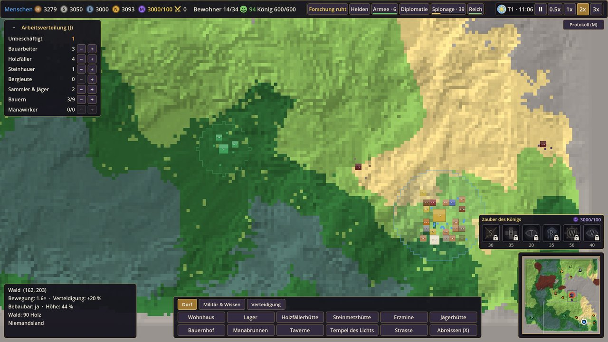

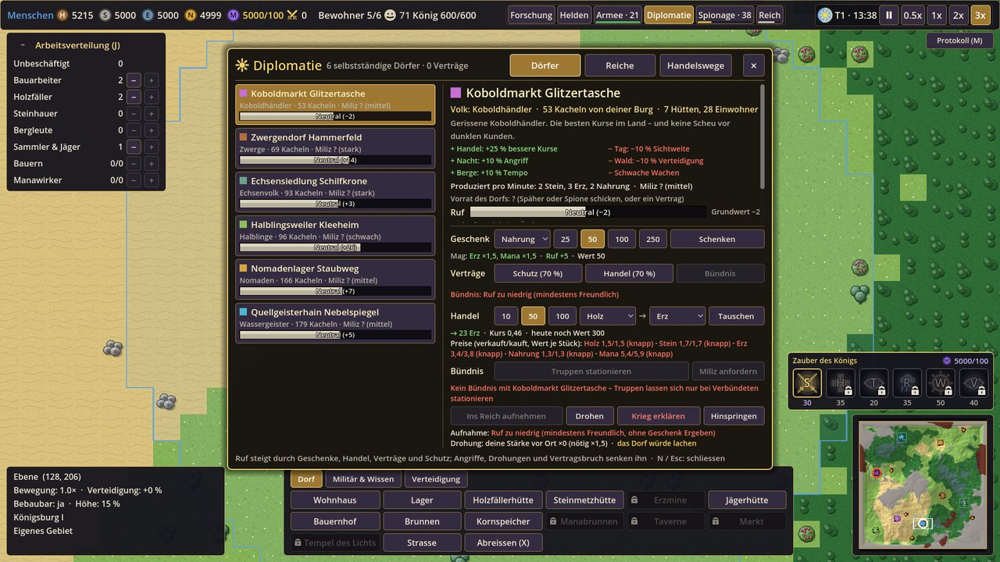

**N** (oder ein Dorfgebäude/eine Miliz anklicken → „Diplomatie (N)“) öffnet das Diplomatiefenster mit den Reitern
*Dörfer*, *Reiche* (nur mit Kundschaft) und *Handelswege*.

### Ruf

| Ruf | Stufe |
|---|---|
| 70 bis 100 | **Ergeben** |
| 30 bis 69 | **Freundlich** |
| −10 bis 29 | **Neutral** |
| −50 bis −11 | **Misstrauisch** |
| −100 bis −51 | **Feindselig** – das Dorf schliesst sich deinem Gegner an |

Der Ruf steigt durch Geschenke, Handel, Verträge und Schutz und sinkt durch Angriffe (−5), getötete Milizen,
zerstörte Gebäude, Drohungen, Kriegserklärungen (−30) und Vertragsbruch (−40). Andere Dörfer hören Gerüchte davon.
Mit der Zeit nähert er sich wieder dem Grundwert.

### Was du tun kannst

| Aktion | So geht's |
|---|---|
| **Geschenk** | Ware und Menge wählen; die Zeile zeigt den Rufgewinn. Lieblingswaren des Volks zählen mehr, viele Geschenke kurz nacheinander weniger |
| **Handel** | Menge und Ware geben, Ware bekommen; Kurs und Tageslimit stehen darunter. Koboldhändler und Nomaden haben die besten Kurse |
| **Schutzvertrag** (ab Neutral) | Das Dorf zahlt Tribut. Wird es angegriffen, musst du binnen 60 s Truppen schicken (roter Punkt am Knopf), sonst sinkt der Ruf |
| **Handelsvertrag** (ab Neutral) | regelmässige Lieferungen, bessere Kurse, höheres Limit, eine Karawane pendelt (siehe [Handelswege](#handelswege)) |
| **Verteidigungsbündnis** (ab Freundlich) | Milizen helfen dir in der Nähe, der **Volkskrieger** erscheint in deiner Kaserne |
| **Aufnehmen** | ab *Ergeben* – oder ab *Freundlich* mit grossem Geschenk bzw. einer 2,5-mal stärkeren Armee in der Nähe. Das Dorfzentrum wird dein Aussenposten, die Milizen deine Truppen, die Produktion fliesst in dein Lager |
| **Drohen** | mit genug Truppen vor Ort zahlt das Dorf Tribut, sonst lacht es dich aus. Der Ruf sinkt so oder so |
| **Krieg** | „Krieg erklären“ oder mit Truppen zweimal Rechtsklick auf eine Miliz oder ein Gebäude des Dorfs (der erste Klick warnt nur). Ein Dorfzentrum auf 0 Leben wird **erobert** (gemindert produktiv, andere Dörfer misstrauen dir). Frieden geht nach 60 s ohne Angriff, wenn der Ruf nicht zu tief ist |

Die Annahme-Chance eines Vertrags steht auf dem Knopf („Schutz (75 %)“), gesperrte Knöpfe nennen den Grund.
„Vertrag kündigen“ braucht einen zweiten Klick und kostet Ruf.

### Boten

Wird ein Dorf angegriffen, schickt es einen sichtbaren **Boten** (Meldung, blinkendes weisses Quadrat auf der
Minikarte) zum nächsten Dorf oder zu einem Gegnerreich. Fängst du ihn ab, erfährt niemand davon – sonst sinkt dein Ruf
auch dort.

## 15. Gegnerische Reiche, Entdeckung und Spionage

Je nach Schwierigkeit und Kartengrösse gibt es ein oder zwei **feindliche Königreiche** der Gegenseite, jedes mit
eigenem Volk. Sie bauen auf wie du, räumen Monsterlager, umwerben Dörfer, forschen, werben Helden an und bauen
Mauern und Türme, wenn sie bedroht werden. Auch untereinander bauen sie Spannung auf bis zum Krieg.

### Entdeckung

Die Gegner wissen anfangs nicht, wo du bist. Oben zeigt **„Spionage · 42“** deinen **Entdeckungswert**: er steigt mit
Gebäuden, Bevölkerung, Armee, Helden und Angriffen (Aggression klingt wieder ab).

| Entdeckungswert | Stufe |
|---|---|
| 0–29 | Unauffällig |
| 30–59 | Bekannt |
| 60–99 | Auffällig |
| ab 100 | Weithin sichtbar |

Daraus entsteht bei jedem Gegnerreich eine **Aufmerksamkeit** (ab 30 Gerüchte, ab 60 bist du entdeckt). Angriffe
kommen erst, wenn du **entdeckt** bist **und** die Wartezeit der Schwierigkeit vorbei ist (Normal: frühestens nach
45 Minuten). *Reichsschleier* / *Reichsschatten* senkt den Entdeckungswert um 40 %.

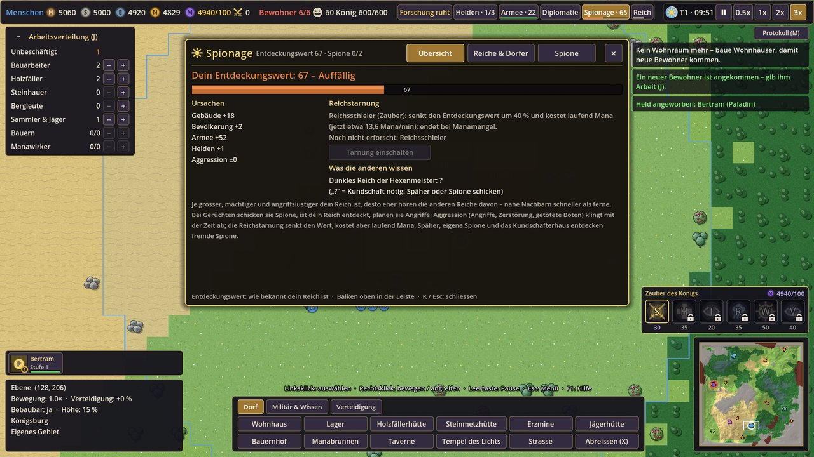

### Kundschaft

Was du über fremde Reiche siehst, hängt an deiner **Kundschaft** (Stufe 0–3): ohne steht im Auswahlfenster nur
„Keine Kundschaft“ und Werte zeigen „?“. Späher, Spione, abgefangene Boten und Kämpfe liefern Kundschaft; sie veraltet
mit der Zeit.

### Spione

Forschung *Kundschafter* (BÖSE: *Spitzel*) → im Spionagefenster (**K**), Reiter „Spione“, „Spion beschwören“ (Burg;
mit dem Kundschafterhaus bzw. der Schattenloge eine Stufe höher). Spione sind immer getarnt und kämpfen nie.
Aufträge:

- **Auskundschaften** – genaue Kundschaft über ein Reich (Stärke, Kriege, Verträge).
- **Dorf aufhetzen** – senkt den Ruf eines Dorfs gegenüber einem Reich.
- **Rivalen aufhetzen** – treibt zwei KI-Reiche in den Krieg gegeneinander.

Die Vorschau zeigt die Entdeckungsgefahr am Ziel. Entdeckte Spione werden kurz sichtbar und fliehen heim; mit
Erfahrung steigen sie bis Stufe 3. Fremde Spione kommen zu dir, sobald ein Reich Gerüchte über dich hört – Späher,
eigene Spione und das Kundschafterhaus entdecken sie (roter Punkt am Spionage-Knopf), dann kann man sie angreifen.

### Angriffswellen

Hat dich ein Reich entdeckt, sammelt es eine **Welle** und schickt sie los (Meldung). Späher melden Truppen nahe der
Grenze, Feinde im eigenen Gebiet werden immer gemeldet. Eine stark geschwächte Welle zieht sich zurück. Gegen Mauern
bringt die KI Rammböcke und Katapulte.

## 16. Ereignisse, Flüchtlinge und Monster

Seltene **Zufallsereignisse** treffen alle Reiche – auch die KI und die Dörfer. Aktive Ereignisse stehen oben in der
Mitte mit Restzeit; die Reichsübersicht (L), Reiter „Ereignisse“, zeigt den Verlauf.

<!-- AUTO:ereignisse -->

| Ereignis | Art | Wirkung | frühestens | Dauer |
|---|---|---|---|---|
| **Dürre** | schlecht | Kein Regen: Höfe und Sammler im Gebiet liefern viel weniger Nahrung. Segensregen hilft. | ab Minute 30 | 10–15 min |
| **Seuche** | schlecht | Eine Krankheit geht um: Kranke arbeiten kaum und stecken andere an. Krankenstation, Heiler und Tempel helfen. | ab Minute 45 | 10–20 min |
| **Magiesturm** | schlecht | Wilde Magie tobt über dem Land: Mana schwankt, Zauber sind billiger und stärker, Blitze schlagen ein. | ab Minute 40 | 5–10 min |
| **Monsterwelle** | schlecht | Eine Horde wilder Monster zieht auf eine Siedlung zu. | ab Minute 35 | 10 min |
| **Flüchtlinge** | Angebot | Menschen auf der Flucht bitten um Aufnahme. Sie brauchen Wohnraum und Nahrung. | ab Minute 25 | – |
| **Wanderer** | Angebot | Reisende Handwerker möchten bleiben und bringen Waren mit. | ab Minute 20 | – |
| **Erntedank** | gut | Eine reiche Ernte: mehr Nahrung und frohe Bewohner. | ab Minute 30 | 10 min |
| **Manablüte** | gut | Die Manaquellen sprudeln: Manabrunnen und Burg liefern mehr Mana. | ab Minute 40 | 7,5 min |

Ereignisse sind selten: frühestens nach 20 Minuten, danach mindestens 25 Minuten Pause zwischen zwei Ereignissen auf der ganzen Karte, ein Reich höchstens alle 50 Minuten.

<!-- /AUTO:ereignisse -->

- **Flüchtlinge und Wanderer** warten am Rand deines Gebiets. Meldung, Leiste oder einen Flüchtling anklicken → Dialog
  mit Wohnraum, Nahrung und Geschenken → **Aufnehmen** oder **Abweisen**. Aufgenommene werden Bewohner; unter ihnen kann
  ein Spion sein, den ein Tempel eher entlarvt. Abgewiesene ziehen weiter – zu einem Dorf oder zum Gegner.
- **Seuche:** Krankenstation, Heiler und Tempel helfen. **Dürre:** Segensregen hilft.

### Wilde Monster

Monsterlager (orange auf der Minikarte) liegen überall; zwei kleine Übungslager 30–45 Kacheln vom Start. Lager
wachsen mit der Zeit, zerstörte entstehen später woanders neu, und Monster ziehen auf **Streifzüge** zu nahen
Siedlungen (nachts häufiger; Minikarte: oranger Ring mit Pfeil). Monster folgen bis 12 Felder von ihrer Höhle.

<!-- AUTO:monster -->

| Monster | Leben | Angriff | Rüstung | Tempo | Kampfpunkte |
|---|---|---|---|---|---|
| **Wolf** | 60 | 8 | 0 % | 3 | 1 |
| **Riesenspinne** | 90 | 10 | 10 % | 2,2 | 2 |
| **Steingolem** | 300 | 22 | 40 % | 1,4 | 5 |
| **Wyvern** | 220 | 18 | 15 % | 3,2 | 4 |

<!-- /AUTO:monster -->

## 17. Tag und Nacht

Neben dem Datum zeigt ein Symbol **Sonne** oder **Mond** (Tooltip: die Boni deines Volks).

| Tageszeit | Uhrzeit | Wirkung |
|---|---|---|
| Morgen | 5:00 – 6:30 | Dämmerung |
| Tag | 6:30 – 19:00 | normale Sicht |
| Abend | 19:00 – 20:30 | Dämmerung, die Welt wird dunkler |
| Nacht | 20:30 – 5:00 | Sicht −20 %, Truppen greifen seltener von selbst an, Wachsamkeit gegen Spione sinkt. Monster +10 % Angriff und Tempo, aufmerksamer, 2,5-mal so viele Streifzüge |

Viele Völker haben eigene Tag- oder Nachtboni (Tabelle bei den [Völkern](#4-fraktionen-und-völker)). Die Abdunklung
lässt sich in den Einstellungen abschalten.

## 18. Mauern, Belagerung und Handelswege

### Mauern, Tore und Türme

Baumenü → **Verteidigung**:

- **Mauer** (Steinmauer / Dornenwall) wie eine Strasse ziehen. Über einer eigenen Strasse entsteht automatisch ein
  **Tor**; ein Tor lässt sich auch auf ein Mauerstück setzen. Schliesst du einen Ring ohne Tor, warnt eine Meldung.
- Eigene Bewohner und Truppen gehen durch Tore, Feinde nicht. Tor auswählen → „Verriegeln“ / „Öffnen“.
- **Wachturm** (Dornenturm): schiesst selbsttätig auf Feinde (Reichweite in der Vorschau).
- Bauarbeiter reparieren beschädigte Mauern, Tore und Türme (kostet Stein). Ein Mauerring und Türme erhöhen die
  Sicherheit (Zufriedenheit).

### Belagerungswaffen

Forschung *Belagerungskunst* (BÖSE: *Kriegsmaschinen*) → **Belagerungswerkstatt** → **Rammbock** (greift nur
Gebäude an, bricht Tore und Mauern) und **Katapult** (schiesst von weit). Rechtsklick auf ein feindliches Gebäude,
Tor oder Mauerstück. Feinde ohne Weg durch eine Mauer greifen das Mauerstück an, das ihnen den Weg versperrt.

### Handelswege

Ein **Handelsvertrag** oder Bündnis mit einem Dorf öffnet einen Handelsweg: eine **Karawane** pendelt (gestrichelte
Linie auf Karte und Minikarte). Diplomatie (N) → „Handelswege“ oder Reichsübersicht (L) → „Handel“ zeigt Ladung,
Lieferungen und Verluste. Feinde am Weg überfallen sie – erst geht die Ladung verloren, dann ist der Weg
abgeschnitten (rotes ✕). Sind keine Feinde mehr da, öffnet er sich nach einigen Minuten, oder du gibst ihn mit
„Weg freigeben“ frei. Überfällst du selbst KI-Karawanen, bekommst du Beute.

### Versorgung

Fern vom eigenen bzw. verbündeten Gebiet und von offenen Handelswegen erholen sich verletzte Truppen nicht
(Wirkung „Ohne Versorgung“). Heiler helfen auch unterwegs.

## 19. Sieg und Niederlage

- Ein Reich **fällt**, wenn sein König stirbt oder seine Burg zerstört wird: Gebäude werden zu Ruinen, Truppen lösen
  sich auf, Verträge enden, das Gebiet verschwindet.
- Sind alle feindlichen Königreiche gefallen, erscheint der **Siegbildschirm** mit Statistik – „Weiterspielen“ oder
  Hauptmenü.
- Fällt **deine** Burg oder stirbt **dein** König, ist das Spiel verloren („Neu starten (gleiche Karte)“ oder
  Hauptmenü). Schütze den König: er ist auch dein einziger Zauberer.

## 20. Schwierigkeitsgrade

<!-- AUTO:schwierigkeit -->

| Stufe | Beschreibung | KI-Reiche (klein / mittel / gross) | erste Welle frühestens | KI Ertrag / Stärke | Monster | deine Startvorräte |
|---|---|---|---|---|---|---|
| **Leicht** | Gemütlich: schwächere und langsamere Gegner, sanfte Monster, mehr Startvorräte. | 1 / 1 / 1 | 75 min | ×0,7 / ×0,8 | ×0,8 | ×1,25 |
| **Normal** | Ausgewogen: Gegner wachsen wie du, erste Angriffe nach einer Dreiviertelstunde. | 1 / 2 / 2 | 45 min | ×1 / ×1 | ×1 | ×1 |
| **Schwer** | Fordernd: die Gegner wirtschaften besser, greifen früher und öfter an. | 2 / 2 / 2 | 30 min | ×1,3 / ×1,15 | ×1,15 | ×1 |
| **Episch** | Für Kenner: starke, schnelle und angriffslustige Gegner, gefährliche Monster. | 2 / 2 / 2 | 20 min | ×1,7 / ×1,3 | ×1,3 | ×1 |

<!-- /AUTO:schwierigkeit -->

Ausserdem wachsen auf höheren Stufen die Monsterlager schneller, Monster streifen häufiger umher und Ereignisse sind
häufiger und stärker. Die genauen Zahlen stehen in der Hilfe (F1, Reiter „Schwierigkeit“).

## 21. Speichern und Laden

- **F5** speichert schnell, **F8** lädt diesen Stand (die vorige Schnellspeicherung bleibt als Sicherung).
- **Esc → Speichern** unter einem Namen (gleicher Name fragt nach), **Laden** zeigt alle Stände mit Datum,
  Spielzeit, Fraktion, Schwierigkeit, Karte und Seed. „Fortsetzen“ im Hauptmenü lädt den neuesten Stand.
- **Automatisch speichern** in den Einstellungen (Abstand wählbar, reihum drei Plätze).
- Ablage: Windows `%APPDATA%\Koenigreiche\saves`, Linux `~/.local/share/Koenigreiche/saves`.

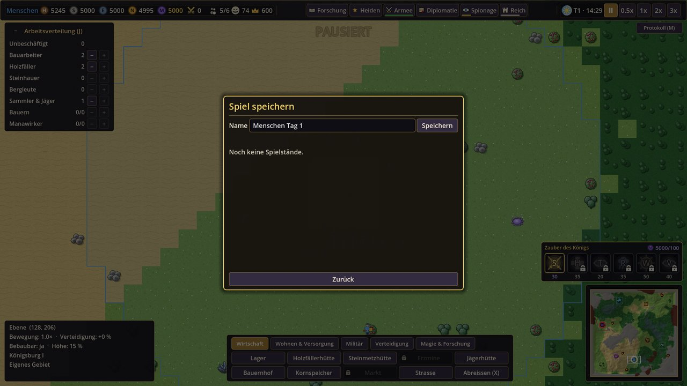

## 22. Tipps für den Einstieg

1. **Zuerst Wohnraum und Nahrung:** zwei Wohnhäuser und einen Bauernhof bauen, neue Bewohner sofort einteilen (J).
2. **Strassen** zwischen Burg, Hütten und Feldern sparen viel Laufzeit.
3. **Sammelhütten** direkt an Wald, Fels und Erz setzen – das macht die Wege kurz und das Sammeln 25 % schneller.
4. **Früh einen Manabrunnen**: Kaserne, Bibliothek und Truppen brauchen Mana.
5. **Kaserne, dann die Übungslager** in der Nähe räumen – das gibt Beute, Kampfpunkte und erste Ränge.
6. **Bibliothek** und die erste Forschung *Waffenschmiede* / *Schwarze Klingen* (Speerträger und Armbrüste) oder
   *Heilkunde* / *Dunkle Heilkunst* (Krankenstation, Heilzauber).
7. **Dörfer umwerben** statt angreifen: ein paar Geschenke in ihren Lieblingswaren, dann ein Handelsvertrag. Ein
   Bündnis schaltet den Volkskrieger frei, eine Aufnahme bringt Gebiet und Produktion.
8. **Gemischte Armeen:** Speerträger vor die Schützen gegen Reiter, eigene Reiter gegen feindliche Schützen und
   Magier, Armbrüste gegen schwere Fusstruppen.
9. **Unauffällig bleiben**, solange du schwach bist: der Entdeckungswert entscheidet, wann die Gegner dich angreifen.
10. **Zufriedenheit im Blick:** Taverne früh, Tempel später, ein Fest in schlechten Zeiten.
11. **Den König schützen** – stirbt er, ist die Partie verloren. Ein Mauerring mit Tor und zwei Türmen um die Burg
    hält die ersten Wellen auf.
12. Im Zweifel: **F1** (Hilfe) und **Leertaste** (Pause). In der Pause kannst du in Ruhe bauen und Befehle geben.
