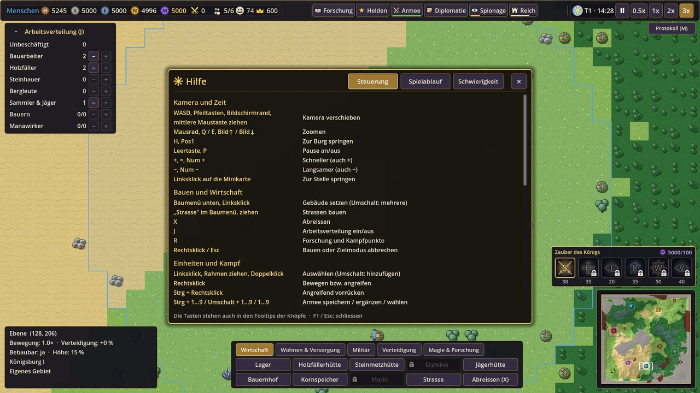

# Steuerung

Alle Tasten und Mausbefehle von **Königreiche** auf einen Blick. Im Spiel stehen sie auch in der Hilfe (**F1**,
Reiter „Steuerung“) und in den Tooltips der Knöpfe.

## Inhalt

1. [Die wichtigsten Tasten](#die-wichtigsten-tasten)
2. [Kamera und Zeit](#kamera-und-zeit)
3. [Bauen und Wirtschaft](#bauen-und-wirtschaft)
4. [Auswahl und Befehle](#auswahl-und-befehle)
5. [Armee und Truppen](#armee-und-truppen)
6. [Helden und Magie](#helden-und-magie)
7. [Reich, Diplomatie und Spionage](#reich-diplomatie-und-spionage)
8. [Meldungen, Speichern und Menü](#meldungen-speichern-und-menü)
9. [Einstellungen](#einstellungen)
10. [Tutorial](#tutorial)
11. [Testhilfen (Debug)](#testhilfen-debug)
12. [Tasten ändern](#tasten-ändern)

## Die wichtigsten Tasten

| Taste | Fenster / Aktion | | Taste | Fenster / Aktion |
|---|---|---|---|---|
| **R** | Forschung | | **J** | Arbeitsverteilung |
| **G** | Helden | | **X** | Abreissen |
| **T** | Armee | | **F** | Formation wechseln |
| **N** | Diplomatie | | **Strg + A** | alle Krieger auswählen |
| **K** | Spionage | | **C / V / B** | Heldenfähigkeiten |
| **L** | Reich (Reichsübersicht) | | **Leertaste / P** | Pause |
| **M** | Meldungsprotokoll | | **+ / −** | Tempo |
| **F1** | Hilfe | | **F5 / F8** | Schnellspeichern / Schnellladen |
| **Esc** | Fenster schliessen, abbrechen, Spielmenü | | **H / Pos1** | zur Burg |

Ein Fenster schliesst sich mit derselben Taste, mit **Esc** oder mit „ד oben rechts. Es ist immer nur ein Fenster in
der Mitte offen – öffnet man ein anderes, schliesst sich das erste.

## Kamera und Zeit

| Aktion | Taste / Maus |
|---|---|
| Kamera verschieben | **W A S D**, Pfeiltasten, Maus an den Bildschirmrand, mittlere Maustaste ziehen |
| Zoomen | Mausrad (zum Mauszeiger hin), **E** (näher) / **Q** (weiter weg), Bild↑ / Bild↓ |
| Zur Burg springen | **H**, Pos1 |
| Minikarte | Linksklick oder Ziehen springt zur Stelle |
| Pause an/aus | **Leertaste**, **P** |
| Spieltempo | **+** / **−** (auch Ziffernblock) oder die Knöpfe oben rechts (Pause, 0.5x, 1x, 2x, 3x) |

## Bauen und Wirtschaft

| Aktion | Taste / Maus |
|---|---|
| Gebäude bauen | Baumenü unten (Reiter *Dorf* / *Militär & Wissen* / *Verteidigung*) → Vorschau (grün = möglich, rot = Grund) → Linksklick |
| Mehrere gleiche Gebäude | Umschalttaste beim Klicken gedrückt halten |
| Strassen | „Strasse“ im Baumenü → Maustaste gedrückt halten und ziehen (bleibt aktiv bis Rechtsklick / Esc) |
| Mauer / Tor | Baumenü → *Verteidigung*: „Mauer“ wie Strassen ziehen (über eigenen Strassen entstehen Tore); „Tor“ auf ein eigenes Mauerstück oder eine Strasse setzen. Tor auswählen → „Verriegeln“ / „Öffnen“ |
| Abreissen | **X** oder „Abreissen“ im Baumenü: Strassen und Mauern anklicken oder überziehen; Gebäude anklicken → „Abreissen“ im Auswahlfenster (zweimal klicken) |
| Bauen abbrechen | Rechtsklick oder **Esc** |
| Arbeitsverteilung | **J** blendet sie ein und aus; „−“ in ihrer Titelzeile klappt sie ein (dann nur „Arbeit · 2 frei“). „+“ / „−“ je Beruf teilen Bewohner zu |
| Sammelpunkt | Burg, Kaserne, Reitstall, Magierturm oder Krankenstation auswählen → Rechtsklick in die Welt |

## Auswahl und Befehle

| Aktion | Taste / Maus |
|---|---|
| Auswählen | Linksklick auf Einheit oder Gebäude; Klick ins Leere oder **Esc** hebt auf; Umschalttaste = hinzufügen |
| Rahmenauswahl | linke Maustaste gedrückt ziehen – wählt eigene Truppen (Bewohner nur, wenn keine Truppen im Rahmen sind) |
| Alle gleichen Einheiten | Doppelklick auf eine Einheit (alle dieses Typs im Bild) |
| Alle Krieger | **Strg + A** (alle eigenen Truppen und Helden, ohne Bewohner und König) |
| Bewegen / Angreifen | Rechtsklick ins Gelände bzw. auf einen Feind (Monster, Höhle, Gebäude) |
| Angreifend vorrücken | **Strg + Rechtsklick** (kämpft unterwegs) oder Knopf „Angriff-Vorrücken“, dann Klick ins Gelände (**Esc** bricht ab) |
| Halt / Zur Arbeit | Knöpfe im Auswahlfenster |
| Armee speichern / ergänzen / wählen | **Strg + 1…9** speichern, **Umschalt + 1…9** hinzufügen, **1…9** auswählen, zweimal drücken = Kamera hin |
| Formation | **F** wechselt reihum Block / Linie / Keil / Kreis, oder Knopf im Auswahl- bzw. Armeefenster |
| Haltung | Zeile „Haltung“ im Auswahlfenster oder im Armeefenster: *Aggressiv*, *Verteidigend* (Standard), *Passiv* |
| Krieg gegen ein Dorf | mit eigenen Truppen **zweimal Rechtsklick** (innerhalb von 3 s) auf eine Einheit oder ein Gebäude des Dorfs – der erste Klick warnt nur – oder „Krieg erklären“ im Diplomatiefenster |
| Belagerungswaffen | Rammbock / Katapult (BÖSE: Sturmbock / Schädelschleuder) auswählen → Rechtsklick auf ein feindliches Gebäude, Tor oder Mauerstück |
| Überläufer aufhalten | dem Überläufer einen Befehl geben (z. B. Rechtsklick ins Gelände oder „Halt“) |

## Armee und Truppen

| Aktion | Taste / Maus |
|---|---|
| Armeefenster | **T** oder Knopf „Armee · 24“ oben (Strich = Leben aller Truppen, roter Punkt = Kampf) |
| … Zeilen | je Einheitentyp, Held und Armee 1–9: „Wählen“ (Befehlsgruppe), „Hin“ (Kamera), „✕“ (Armee auflösen) |
| … Auswahl | „Alle Krieger auswählen (Strg+A)“, „Untätige“, „Verwundete“, Auswahl als Armee 1–9 speichern |
| … Befehle an die Gruppe | Sammeln an der Burg, Rückzug zur Burg, Angreifend vorrücken …, Bewegen …, Patrouille … (danach Ziel anklicken), Halten, Stationieren … (bei einem Verbündeten, Dorf aus der Liste), Zurückrufen (Stationierte), Formation, Haltung |
| Einheiten beschwören | Gebäude auswählen (Burg, Kaserne, Reitstall, Magierturm, Krankenstation, Belagerungswerkstatt) → Knöpfe im Raster; Kosten auf dem Knopf, Dauer, Klasse und Konter im Tooltip. Klick auf ein Symbol der Warteschlange bricht ab |
| Wertepunkte verteilen | Truppe auswählen → „Angriff +“, „Leben +“, „Rüstung +“, „Tempo +“ (nur sichtbar, solange Punkte frei sind) |
| Punkte automatisch verteilen | mehrere Truppen auswählen → „Verteilen“; Häkchen „automatisch“ = für das ganze Reich bei jedem Aufstieg |
| Aussehen (Skins) | Truppe auswählen → „Aussehen“ → „Alle: …“ (ganzer Typ) bzw. „Diese: …“ (nur diese Einheit; Heldenbanner ab Rang Elite) |
| Schmiede | Schmiede (BÖSE: Blutschmiede) auswählen → je Truppenklasse „Waffen x/3“ und „Rüstung x/3“ |

## Helden und Magie

| Aktion | Taste / Maus |
|---|---|
| Heldenfenster | **G** oder Knopf „Helden“ oben: eigene Helden (Stufenwahl, Ausbildung, Wiederbelebung) und Anwerben |
| Helden auswählen | Heldenleiste unten links: Klick wählt, Doppelklick springt hin, Rechtsklick öffnet das Heldenfenster; gefallener Held: Klick belebt wieder (wenn möglich) |
| Heldenfähigkeiten | **C / V / B** oder die Knöpfe im Auswahlfenster – auch mit der ganzen Armee ausgewählt |
| Nächster Held der Auswahl | **Tab** |
| Fähigkeit selbst auslösen | Rechtsklick auf einen Fähigkeitsknopf (goldener Rahmen = an) |
| Fähigkeit mit Ziel | Feind bzw. Stelle anklicken; Rechtsklick / **Esc** bricht ab |
| Forschung | **R** oder Knopf „Forschung“ oben: Reiter „Forschungsbaum“ und „Kampfpunkte“. Klick erforscht, Klick auf eine laufende Forschung bricht ab (zweiter Klick bestätigt) |
| Zaubern | Zauber in der Zauberleiste (unten rechts) anklicken → Kreis an die Stelle führen → Linksklick; Rechtsklick / **Esc** bricht ab |

## Reich, Diplomatie und Spionage

| Aktion | Taste / Maus |
|---|---|
| Diplomatie | **N** oder Knopf „Diplomatie“: Reiter „Dörfer“, „Reiche“ (nur mit Kundschaft), „Handelswege“. Dorfgebäude, Miliz oder Bote auswählen → „Diplomatie (N)“ |
| Spionage | **K** oder Knopf „Spionage · 42“ (Zahl und Strich = dein Entdeckungswert, roter Punkt = Gefahr): Reiter „Übersicht“, „Reiche & Dörfer“, „Spione“ |
| Spion: Auftrag | Spion auswählen → „Auftrag (K)“, oder Spionagefenster → „Spione“: Auftrag und Ziel wählen → „Auftrag erteilen“; „Zurückrufen“ holt ihn heim |
| Reichsübersicht | **L** oder Knopf „Reich“: Reiter „Zufriedenheit“, „Ereignisse“, „Volk & Tageszeit“, „Handel“. Das Gesicht in der Ressourcenleiste und Sonne/Mond neben dem Datum öffnen sie ebenfalls |
| Handelswege | N → „Handelswege“ oder L → „Handel“: Karawanen, Ladung, Lieferungen, Verluste, „Weg freigeben“, Versorgung |
| Flüchtlinge | Meldung, Ereignisleiste (oben Mitte) oder einen Flüchtling anklicken → „Aufnehmen“ / „Abweisen“ |

## Meldungen, Speichern und Menü

| Aktion | Taste / Maus |
|---|---|
| Meldungen | oben rechts; Klick springt zur Stelle bzw. öffnet das passende Fenster. Ältere stehen im Protokoll |
| Meldungsprotokoll | **M** oder Knopf „Protokoll (M)“: alle Meldungen der Partie, Filter, Klick springt zur Stelle |
| Schnellspeichern / Schnellladen | **F5** / **F8** (die vorige Schnellspeicherung bleibt als Sicherung) |
| Spielmenü | **Esc**, wenn kein Fenster offen ist und nichts gebaut oder ausgewählt wird: Fortsetzen, Speichern, Laden, Einstellungen, Hilfe, Tutorial, Hauptmenü, Beenden |
| Hilfe | **F1** (auch im Spielmenü): Reiter „Steuerung“, „Spielablauf“, „Schwierigkeit“ |
| Grösse der Oberfläche | Esc → Einstellungen → Reiter „Oberfläche“ → „Grösse der Oberfläche“ (75–150 %, wirkt sofort) |

**Esc der Reihe nach:** zuerst schliesst Esc ein offenes Fenster, dann bricht es einen Zielmodus oder das Bauen ab,
dann hebt es die Auswahl auf – erst danach öffnet es das Spielmenü.

**F5 im Editor:** Im Godot-Editor startet F5 das Projekt; im laufenden Spiel ist F5 *Schnellspeichern*.

## Einstellungen

Hauptmenü → „Einstellungen“ oder Esc → „Einstellungen“. Alle Werte wirken sofort und stehen nach „Speichern und
zurück“ in `user://settings.cfg` (auch nach einem Neustart); „Standard“ setzt alle Reiter zurück.

| Reiter | Einstellungen |
|---|---|
| **Grafik** | Vollbild, VSync, Bildrate-Grenze (30 / 60 / 120 / unbegrenzt), Tag-Nacht-Abdunklung |
| **Ton** | Lautstärke Gesamt, Musik, Effekte, Oberfläche |
| **Steuerung** | Kamera am Bildschirmrand an/aus, Kamera-Tempo der Tasten, Tempo am Bildschirmrand (getrennt), Zoom-Tempo (Mausrad, Q/E) |
| **Oberfläche** | Grösse der Oberfläche (75–150 %), Lebensbalken (immer / nur verletzt oder ausgewählt / nur ausgewählt), wie lange Meldungen sichtbar bleiben (4–20 s), Grösse der Minikarte (75–150 %) |
| **Spiel** | Automatisch speichern, Spielstände komprimieren, Tempo zu Beginn einer Partie, Rückfrage vor einer Kriegserklärung (aus: der erste Rechtsklick auf ein friedliches Dorf bzw. „Krieg erklären“ gilt sofort), Tooltip-Verzögerung (gilt ab dem nächsten Start – Godot liest sie nur beim Programmstart; sie steht in `user://project_override.cfg`) |

## Tutorial

| Aktion | Taste / Maus |
|---|---|
| Tutorial starten | Hauptmenü → „Tutorial“ oder beim neuen Spiel „Tipps/Tutorial anzeigen“ |
| Im Tutorial-Fenster (rechts) | „Weiter“ (nur bei Erklärschritten), „Überspringen“ (lange Schritte), „Beenden“ (zweimal klicken), „–“ klappt ein, „Zeigen“ springt zum Pfeil |
| Fortsetzen / neu beginnen | Spielmenü (Esc) → „Tutorial fortsetzen (Schritt 7/35)“ bzw. „Tutorial von vorn“ |

Klicks gehen durch den goldenen Rahmen und den Pfeil hindurch – man bedient das Spiel ganz normal.

## Testhilfen (Debug)

**F3** blendet die Debug-Anzeige ein (FPS, Zoom, Chunks). Nur solange sie an ist, wirken:

| Taste | Wirkung |
|---|---|
| **F9** | +100 von jeder Ressource |
| **F10** | König −150 Leben (Spielende testen) |
| **F11** | 3 Wölfe an der Maus |
| **Umschalt + F11** | Übungsgolem an der Maus (viel Leben und Rüstung) |
| **Strg + F11** | feindlicher Rammbock gegen deine Burg |
| **F12** | ausgewählter Held +1 Stufe |

Dazu erscheinen Debug-Knöpfe: „+50 EP (Test)“ im Auswahlfenster einer Truppe, „+1 Stufe“, „Abklingzeiten“, „Sofort
wiederbeleben“, „Held fällt“ im Heldenfenster, „Ruf +20 / −20“, „Bote senden (Test)“ und „Besiegen (Test)“ in der
Diplomatie, „Aufmerksamkeit +30“, „Volle Kundschaft“, „KI greift jetzt an“, „KI-Reich besiegen“, „Rivalen: Krieg“ in
der Spionage sowie Ereignisse, Zufriedenheit, Überläufer, Verrat und Tageszeit in der Reichsübersicht.

## Tasten ändern

Die Tastenbelegung steht in `project.godot`. Ändern im Godot-Editor unter **Projekt → Projekteinstellungen →
Eingabe-Zuordnung**. Die Hilfe (F1) liest die Tasten aus dieser Belegung und zeigt immer die aktuelle Taste.

| Aktion in `project.godot` | Standard |
|---|---|
| `camera_up` / `camera_down` / `camera_left` / `camera_right` | W / S / A / D und Pfeiltasten |
| `camera_zoom_in` / `camera_zoom_out` | E, Bild↑ / Q, Bild↓ |
| `camera_home` | H, Pos1 |
| `game_pause` | Leertaste, P |
| `game_speed_up` / `game_speed_down` | +, =, Ziffernblock + / −, Ziffernblock − |
| `game_menu` | Esc |
| `toggle_jobs` | J |
| `demolish_mode` | X |
| `toggle_formation` | F |
| `toggle_research` | R |
| `toggle_heroes` | G |
| `toggle_army` | T |
| `select_all_warriors` | Strg + A |
| `toggle_diplomacy` | N |
| `toggle_espionage` | K |
| `toggle_kingdom` | L |
| `toggle_log` | M |
| `toggle_help` | F1 |
| `hero_ability_1` / `_2` / `_3` | C / V / B |
| `hero_cycle` | Tab |
| `quick_save` / `quick_load` | F5 / F8 |
| `toggle_debug` | F3 |
| `debug_resources` / `debug_damage_king` / `debug_spawn_wolves` / `debug_hero_level` | F9 / F10 / F11 / F12 |

Die Zeilen der Hilfe (F1) stehen in `data/help.json` (siehe [Daten anpassen](daten-anpassen.md#helpjson)).
